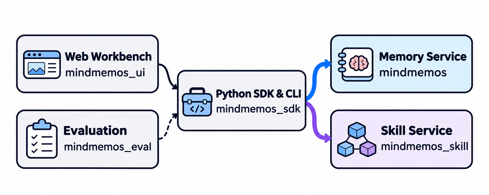

# MindMemOS

**为 AI Agent 提供长期记忆，以及可复用、可持续改进的 Skill。**

<p align="center">
  
</p>

<p align="center">
  <a href="https://mindmemos.cn">
    
  </a>
  <a href="https://mindmemos.cn/#/api-docs">
    
  </a>
  <a href="https://pypi.org/project/mindmemos-sdk/">
    
  </a>
  <a href="https://www.npmjs.com/package/@mindmemos/openclaw-plugin">
    
  </a>
  <a href="https://www.npmjs.com/package/@mindmemos/deepseek-harness-plugin">
    
  </a>
  <a href="https://arxiv.org/abs/2608.12428">
    
  </a>
  <a href="#license">
    
  </a>
</p>

<p align="center">
  <strong><a href="README.md">English</a></strong>
  &nbsp;&nbsp;│&nbsp;&nbsp;
  <strong><a href="https://mindmemos.cn">官网</a></strong>
  &nbsp;&nbsp;│&nbsp;&nbsp;
  <strong><a href="https://mindmemos.cn/#/api-docs">API 文档</a></strong>
  &nbsp;&nbsp;│&nbsp;&nbsp;
  <strong><a href="https://pypi.org/project/mindmemos-sdk/">PYPI SDK</a></strong>
  &nbsp;&nbsp;│&nbsp;&nbsp;
  <strong><a href="docs/deploy/instruction_ZH.md">如何部署</a></strong>
</p>

> ⭐ **GitHub Star 后自动升级 Pro 额度会员。**

## 📰 News

- **2026-11-09** — 我们正式发布 **MindMemOS-Skill**。它是可独立部署的 Skill 服务，支持管理 Skill 版本、训练和演化 Skill、构建Skill图谱并推荐最优Skill组合。[快速开始](#1-注册账号并创建-api-key)
- **2026-08-18**：我们发布了 [DeepSeek Harness 插件](https://www.npmjs.com/package/@mindmemos/deepseek-harness-plugin)，让 DeepSeek Harness（dsh）Agent 自动召回并写入 MindMemOS 记忆。
- **2026-08-14**：我们发布了 [MindMemOS 1.0 技术报告](https://arxiv.org/abs/2608.12428)《MindMemOS: A Portable and Self-Evolving Memory Operating Layer for AI Agents》。
- **2026-07-17**: MindMemOS 接入 [LLM4AD_NEXT](https://github.com/Optima-CityU/LLM4AD_Next)，为算法设计任务提供可检索的长期记忆能力，实现跨任务经验、领域知识与约束条件的沉淀和复用。
- **2026-06-30**：MindMemOS 正式发布！

> **Skill API 更新提示。** 旧版 Skill API 已弃用。新版 Skill 服务地址为 `https://mindmemos.cn/v2/skills`。请将 `mindmemos-sdk` 升级至 **1.0.0 或更高版本**。如果使用 OpenClaw 或 DeepSeek Harness，请同时将对应的 `@mindmemos/openclaw-plugin` 或 `@mindmemos/deepseek-harness-plugin` 升级至 **0.2.0 或更高版本**。升级后，先在 MindMemOS 控制台编辑项目 API Key，添加 `skill:read` 和 `skill:write`，保存后再用同一个 Key 运行 `mindmemos auth`。下方快速开始提供了从本仓库安装这些版本的步骤。[新版 Skill 服务权限设置](#为项目-api-key-开通新版-skill-服务权限)

## 🌟 Core Features

- **跨 Agent 可迁移**：将用户画像、偏好、项目事实、工具经验和 skill candidates 沉淀为可复用资产，让 OpenClaw、Hermes、Claude Code、OpenHands 等不同 Agent 共享或迁移同一套长期记忆。
- **记忆系统可自主演化**：通过 schema learning、dreaming、feedback 持续优化记忆质量，自动学习高频记忆点、离线巩固合并记忆，并从交互纠错中反向优化 add/search 流程。
- **从任务和历史轨迹中改进 Skill**。MindMemOS-Skill 支持注册 Skill、管理版本、保存 Agent 执行轨迹，并对 Skill 和执行轨迹评分。你可以构建和管理 Skill 图谱，按任务推荐合适的 Skill 组合，也可以用 TreeSkill 或 Skill-Forest 基于任务训练 Skill，或用已保存的轨迹离线演化指定版本。你可以独立部署 Skill API，也可以直接调用 Python 服务。
- **本机 Web 工作台**可通过 SDK 连接 Memory 和 Skill 服务，搜索和编辑记忆、管理 Skill 版本、查看图谱快照、预览动态 Skill，并编辑服务连接配置。
- **插件集成能力**：支持通过插件将 MindMemOS 接入不同 Agent 与工作流，在交互前检索并注入相关记忆、回合结束后自动写回对话，当前已提供 [OpenClaw 插件](https://www.npmjs.com/package/@mindmemos/openclaw-plugin) 和 [DeepSeek Harness 插件](https://www.npmjs.com/package/@mindmemos/deepseek-harness-plugin)，并持续扩展更多集成。

### 项目组成与服务关系



| 包 | 提供的能力 | 使用方式 |
| --- | --- | --- |
| `src/mindmemos` | 记忆写入、检索、查询、修改、删除、反馈与巩固（dreaming） | Memory HTTP API |
| `src/mindmemos_skill` | Skill 注册、版本管理、轨迹保存、训练与演化，已发布图的查询和管理 | Python Service、本地 CLI 或 Skill HTTP API |
| `src/mindmemos_sdk` | 调用 Memory 与 Skill API，管理连接和凭据 | Python SDK 与 `mindmemos` CLI |
| `src/mindmemos_eval` | Memory 和 Skill 测评，汇总评分、耗时与模型用量 | `mindmemos-eval` 与评测配置 |
| `src/mindmemos_ui` | Memory 与 Skill 的本机 Web 工作台 | 浏览器访问 UI，UI 后端通过 SDK 调用服务 |

Memory 与 Skill 各自管理业务数据，可分别部署。默认本地部署中，Memory 使用 Qdrant 和 Neo4j，Skill 使用独立 PostgreSQL；直接使用 Skill Python Service 时也可配置 SQLite。两个 API 可共享 Kafka 和监控设施，UI 通过 SDK 访问业务数据。

## 🚀 快速开始

### 1. 注册账号并创建 API Key

[注册 MindMemOS 账号](https://mindmemos.cn/#/register)并登录控制台。打开已有项目或新建项目。首次使用时，在 **API Keys** 页面点击 **创建 API Key**，选择对应项目和所需权限，创建后保存完整 Key。

#### 为项目 API Key 开通新版 Skill 服务权限

1. 登录 [MindMemOS 控制台](https://mindmemos.cn/)，打开 **API Keys**（API 密钥）。按名称和前缀找到 SDK 或插件当前使用的项目 Key，进入权限编辑。
2. 在 **权限** 中新增 `skill:read` 和 `skill:write`。`skill:read` 用于查看 Skill 和版本，`skill:write` 用于注册 Skill、写入新版本和上报执行轨迹。同时使用 Memory 时，保留已有的 `memory:read` 和 `memory:write`。
3. 保存权限，在 Key 列表的 **权限** 列确认 `skill:read` 和 `skill:write` 已显示。
4. 按[接入 Python SDK](#2-接入-python-sdk)中的命令重新运行 `mindmemos auth`，选择官方服务，按提示输入刚完成授权的项目 Key。用 `mindmemos skill list --limit 1` 验证读取权限，再用下方的 Skill 注册示例验证写入权限。

### 2. 接入 Python SDK

准备 Python 3.11–3.13 和 uv，在仓库根目录运行以下命令，按提示输入已配置权限的项目 API Key。SDK 和 Agent 插件共用这份配置。

官方模式下省略两个 `base_url`。Memory 继续使用 `https://mindmemos.cn` 和原项目 Key，请求路径仍是 `/v1/memory/*`。新版 Skill 的 API 根地址是 `https://mindmemos.cn/v2/skills`，使用具有 Skill 权限的项目 Key。网关负责转发到独立 Skill 服务，对外地址保持稳定时，云端调整内部路由无需修改本地配置。

```bash
uv sync --package mindmemos-sdk --no-dev --inexact
uv run --no-sync mindmemos auth --service-type official --user-id alice
uv run --no-sync mindmemos memory get --top-k 1
```

把 `alice` 替换为应用中的用户 ID。如果项目 Key 已获 Skill 权限，再运行以下命令验证 Skill 连接。

```bash
uv run --no-sync mindmemos skill list --limit 1
```

用 `uv run --no-sync python` 分别运行下面两个示例。

**Memory：写入并检索记忆**

```python
from mindmemos_sdk import DialogueMessage, MindMemOSClient

user_id = "alice"

with MindMemOSClient(user_id=user_id) as client:
    client.memory.add(
        messages=[DialogueMessage(role="user", content="我喜欢喝冰美式。")],
        mode="sync",
    )
    result = client.memory.search("咖啡偏好", user_id=user_id, top_k=3)
    for memory in result.memories:
        print(memory.memory)
```

**Skill：注册 Skill 并读取首个版本**

此示例需要具备 Skill 读写权限的项目 API Key。

```python
from mindmemos_sdk import MindMemOSClient
from mindmemos_sdk.skills import RegisterRequest, ShowRequest, StructuredSkillInfo

skill_content = """---
name: meeting-summary
description: Summarize meeting notes into decisions and action items.
---
List decisions first. Then list each action item with its owner and deadline.
"""

with MindMemOSClient() as client:
    created = client.skills.register(
        RegisterRequest(skill=StructuredSkillInfo(content=skill_content, commit_version="v1.0.0"))
    )
    version_id = created["skill_version_id"]
    detail = client.skills.show(ShowRequest(skill_version_id=version_id))
    print(version_id)
    print(detail["version"]["content"])
```

SDK 文档提供了[注册 Skill 和管理版本](src/mindmemos_sdk/README.md#python-sdk)与[向两个服务统一上报执行轨迹](src/mindmemos_sdk/README.md#统一上报执行轨迹)的示例。

### 3. 接入 OpenClaw

构建插件需要 Node.js 和 npm。安装 OpenClaw 后，在仓库根目录构建并链接插件，让 Gateway 使用第 2 步已配置认证的 CLI。

```bash
(cd plugins/openclaw-plugin && npm ci && npm run build)
openclaw plugins install --link "$PWD/plugins/openclaw-plugin"
openclaw plugins enable mindmemos-memory
openclaw config set plugins.entries.mindmemos-memory.config.cli "$PWD/.venv/bin/mindmemos"
openclaw config set plugins.entries.mindmemos-memory.config.userId alice
openclaw config set plugins.entries.mindmemos-memory.hooks.allowConversationAccess true
openclaw gateway restart
openclaw skills list
```

插件在模型运行前从 **Memory** 召回相关记忆，回合完成后写回对话。Agent 可通过 OpenClaw Skill 目录中的 `mindmemos-cli` 指南查找和加载远端 Skill。插件向 **Skill** 上报执行轨迹，并关联检测到的确切版本。详见 [OpenClaw 接入指南](skills/mindmemos-cli/references/openclaw-plugin.md)。

### 4. 接入 DeepSeek Harness

使用提供 `agents` 和 `skills` 服务的 dsh profile，然后在仓库根目录构建插件。

```bash
(cd plugins/deepseek-harness-plugin && npm ci && npm run build)
```

把以下条目加入该 profile 的 `cordis.patch.yml`。将 `/path/to/MindMemOS` 换成仓库绝对路径，再用该 profile 重启 dsh。

```yaml
- insert:
    - id: mindmemos-memory
      name: 'file:///path/to/MindMemOS/plugins/deepseek-harness-plugin/dist/index.js'
      config:
        cli: /path/to/MindMemOS/.venv/bin/mindmemos
        userId: alice
```

插件在模型执行第一步前从 **Memory** 召回相关记忆，回合完成后写回对话。插件把 `mindmemos-cli` 注册到 dsh 的 Skill 目录，供 Agent 查找和加载远端 Skill。插件向 **Skill** 上报执行轨迹，并关联检测到的确切版本。详见 [DeepSeek Harness 接入指南](skills/mindmemos-cli/references/deepseek-harness-plugin.md)。

两个插件都需要让 Agent 的 shell 能找到 `mindmemos`，并使用第 2 步的 SDK 配置目录。若设置了 `MINDMEMOS_HOME`，请让插件宿主和 Agent 的 shell 使用同一个目录。完成一个测试回合后，在插件日志中查看 `Memory queued` 或 `Memory completed`。如果 Key 已获 Skill 权限，再检查同一事件 ID 下是否有 `Skill stored`。详见[加载并关联确切的 Skill 版本](skills/mindmemos-cli/SKILL.md#recommend-and-load-a-skill)。

### 自部署 Memory 和 Skill

准备 Python 3.11–3.13、uv、Make 和 Docker Compose，然后在仓库根目录运行以下命令。

```bash
uv sync --all-packages --extra postgres --extra kafka
export UV_NO_SYNC=1
test -f .env || cp .env.example .env
# 在 .env 中填写对话模型和嵌入模型的连接信息。
make init
```

在 `config/presets/local.project.yaml` 中为本地项目设置 API Key。项目需要 `memory:read`、`memory:write`、`skill:read` 和 `skill:write` 权限。按[部署指南](docs/deploy/instruction_ZH.md#12-初始化--填写配置文件)补齐服务配置，然后启动两个 API。

```bash
uv run --no-sync python scripts/install_nlp_assets.py
uv run --no-sync python scripts/check_nlp_assets.py
make dev SERVICE=all FEATURE=async UI=0
```

[Memory](http://127.0.0.1:8000/docs) 默认监听 8000 端口，[Skill](http://127.0.0.1:8001/docs) 默认监听 8001 端口。`FEATURE=async` 启用插件默认写入 Memory 时使用的队列。另开终端，配置两个本地服务地址。两次提示均输入本地项目 API Key。

- `--memory-base-url` 填服务地址，由 SDK 拼接 `/v1/memory/...`。
- `--skill-base-url` 填完整的 Skill API 根地址。直连独立服务时包含 `/v1/skills`，SDK 只追加操作名。旧配置如果只填了 Skill 服务地址，仍可继续使用。

```bash
uv run --no-sync mindmemos auth --service-type custom \
  --memory-base-url http://127.0.0.1:8000 \
  --skill-base-url http://127.0.0.1:8001/v1/skills \
  --user-id alice
```

Web 工作台和其他启动方式见[部署指南](docs/deploy/instruction_ZH.md)。

## 📊 Benchmark

粗体标出同组、同指标的最高分，包含并列。

### Memory 基准评测

#### LoCoMo

长对话记忆问答，覆盖单跳、多跳、时序和开放域任务。[LoCoMo 论文](https://arxiv.org/abs/2402.17753)

| 方法 | Single-hop | Multi-hop | Temporal | Open-domain | Overall |
| --- | ---: | ---: | ---: | ---: | ---: |
| Mem0 | 68.97 | 61.70 | 58.26 | 50.00 | 64.20 |
| MemU | 74.91 | 72.34 | 43.61 | 54.17 | 66.67 |
| MemOS | 85.37 | 79.43 | 75.08 | 64.58 | 80.76 |
| Zep | 90.84 | 81.91 | 77.26 | 75.00 | 85.22 |
| EverOS | 96.67 | 91.84 | 89.72 | 76.04 | 93.05 |
| MindMemOS-MindVanilla | 92.03 | 85.82 | 83.80 | 66.67 | 87.60 |
| MindMemOS-MindSchema | **96.79** | **93.97** | **90.34** | **82.29** | **94.03** |

#### PersonaMem

用户画像与偏好理解，按题型统计准确率。[PersonaMem 论文](https://arxiv.org/abs/2504.14225)

| Method | Recall | Ack. Lat. | Trk. Evo. | Revisit | Suggest | Recom. | General. | Overall |
| --- | ---: | ---: | ---: | ---: | ---: | ---: | ---: | ---: |
| Mem0 | 46.51 | 41.18 | 65.47 | **90.91** | 12.90 | 34.55 | 43.86 | 51.61 |
| MemU | 64.34 | 64.71 | 66.20 | 87.88 | 31.18 | 67.27 | **84.21** | 65.70 |
| MemOS | 53.49 | 82.35 | **66.91** | 79.80 | 41.94 | 69.09 | 75.44 | 63.67 |
| EverOS | 74.42 | 64.71 | 64.03 | 85.86 | 35.48 | 65.45 | **84.21** | 67.57 |
| MindMemOS-MindVanilla | 76.74 | **88.24** | 65.47 | 87.88 | 17.20 | **80.00** | 82.46 | 67.74 |
| MindMemOS-MindSchema | **81.40** | 64.71 | 64.75 | 82.83 | **47.31** | 76.36 | 73.68 | **70.63** |

#### MemoryAgentBench

FactConsolidation 分数为四种上下文规模下的平均 Substring Exact Match。[MemoryAgentBench 论文](https://arxiv.org/abs/2507.05257)

| 模型 | Method | SH score | SH archived | MH score | MH archived |
| --- | --- | ---: | ---: | ---: | ---: |
| GPT-4o-mini | Mem0 | 0.180 | — | 0.020 | — |
|  | MemoRAG | 0.270 | — | 0.070 | — |
|  | HippoRAG-v2 | 0.540 | — | 0.050 | — |
|  | MindMemOS-MindVanilla | 0.635 | — | 0.118 | — |
|  | MindMemOS-MindVanilla + Dreaming | **0.738** | 21.4% | **0.180** | 19.4% |
| GPT-5-mini | Infini Memory | 0.800 | — | 0.220 | — |
|  | MindMemOS-MindVanilla | 0.900 | — | 0.190 | — |
|  | MindMemOS-MindVanilla + Dreaming | **0.920** | 23.5% | **0.250** | 21.5% |

### Skill 基准评测

#### Skill-Forest

各基准的 Hard 分数（%）取留出测试集三轮运行的平均值，总体分数对五个基准等权平均。Select 和 Merge 各使用 7 棵树。[评测配置与结果](docs/evaluation/skill_evaluation_ZH.md#验证结果)

| 方法 | LiveMath | ALFWorld | SpreadsheetBench Verified 400 | SearchQA | OfficeQA | 总体 |
| --- | ---: | ---: | ---: | ---: | ---: | ---: |
| 无 Skill | 27.42 | 56.97 | 80.24 | 76.90 | 28.49 | 54.00 |
| 初始 Skill | 28.23 | 70.65 | 79.40 | 76.67 | 43.99 | 59.79 |
| Trace2Skill | 27.69 | 76.62 | 81.79 | 77.50 | 54.84 | 63.69 |
| GEPA | 31.45 | 79.85 | **82.26** | 79.62 | 53.68 | 65.37 |
| SkillOpt | 31.72 | 75.37 | 80.71 | **80.67** | 52.71 | 64.24 |
| Select | **36.02** | 82.34 | 81.67 | 80.21 | 53.88 | 66.82 |
| Merge | 34.68 | **82.84** | 81.07 | 80.52 | **55.23** | **66.87** |

#### TreeSkill

下表为 SpreadsheetBench 域内评测结果。括号内是相对于同一执行模型的人工编写 Skill 的提升，单位为百分点。35B 的对照分数引自已有报告，TreeSkill 两组结果和 9B 对照由本项目实测。[评测配置与结果](docs/evaluation/skill_evaluation_ZH.md#spreadsheetbench-域内评测结果)

| 执行模型 | 方法 | Vrf (%) | Soft (%) | Hard (%) |
| --- | --- | ---: | ---: | ---: |
| Qwen3.5-35B-A3B | No Skill | 19.00 | 18.00 | 4.60 |
|  | Human-Written Skill | 9.67 | 13.03 | 3.37 |
|  | Trace2Skill +Combined | 29.67 (+20.00) | 18.80 (+5.77) | 5.73 (+2.36) |
|  | SkillCAT | 55.50 (+45.83) | 39.02 (+25.99) | 20.61 (+17.24) |
|  | TreeSkill (routed) | **66.00 (+56.33)** | **41.72 (+28.69)** | **25.22 (+21.85)** |
| Qwen3.5-9B | No Skill | 25.50 | 21.00 | 9.21 |
|  | Human-Written Skill | 14.00 | 16.76 | 7.24 |
|  | Trace2Skill +Combined | 16.50 (+2.50) | 18.97 (+2.21) | 8.66 (+1.42) |
|  | TreeSkill (routed) | **45.50 (+31.50)** | **30.28 (+13.52)** | **14.58 (+7.34)** |

#### Skill Graph

##### Skill 检索

Skill Graph 表格中的下划线标出第二名，含并列。星号表示分数引自对应方法的原论文。[检索评测结果](docs/evaluation/skill_evaluation_ZH.md#对标结果)

**ALFWorld**

| 方法 | Ret@1 | Ret@K | MRR |
| --- | ---: | ---: | ---: |
| Vector Skills | 0.7 | 4.5 | 0.4 |
| SkillRouter (Emb.) | 13.6 | 48.6 | 26.2 |
| SkillRouter (Emb.+RR) | 12.1 | **74.3** | <ins>36.2</ins> |
| AgentSkillOS | 0.7 | 50.7 | 18.5 |
| SkillRAE | 9.3 | 35.6 | 17.5 |
| GoS | 8.6 | 9.3 | 8.9 |
| SkillDAG | <ins>20.0</ins> | 44.8 | 29.2 |
| MindMemOS Skill Graph | **49.3** | <ins>71.4</ins> | **57.9** |

**AgentSkillOS**

| 方法 | Ret@1 | Ret@K | MRR |
| --- | ---: | ---: | ---: |
| Vector Skills | 56.7 | 83.3 | 66.2 |
| SkillRouter (Emb.) | 50.0 | <ins>86.7</ins> | 64.3 |
| SkillRouter (Emb.+RR) | 56.7 | 70.0 | 61.9 |
| AgentSkillOS | 70.0 | 83.3 | 76.7 |
| SkillRAE | 40.0 | 80.0 | 55.2 |
| GoS | <ins>76.7</ins> | <ins>86.7</ins> | <ins>80.3</ins> |
| SkillDAG | 43.3 | 56.1 | 60.8 |
| MindMemOS Skill Graph | **80.0** | **93.3** | **83.3** |

**SkillsBench**

| 方法 | Ret@1 | Ret@K | MRR |
| --- | ---: | ---: | ---: |
| Vector Skills | 3.6\* | 10.8\* | 5.8\* |
| SkillRouter (Emb.) | <ins>77.6</ins> | **93.4** | <ins>83.1</ins> |
| SkillRouter (Emb.+RR) | **81.6** | <ins>88.2</ins> | **84.5** |
| AgentSkillOS | 38.2 | 44.7 | 41.0 |
| SkillRAE | 69.7 | 86.8 | 76.8 |
| GoS | 50.6\* | 65.5\* | 57.3\* |
| SkillDAG | 66.7\* | 78.2\* | 71.3\* |
| MindMemOS Skill Graph | 69.2 | 86.8 | 76.8 |

##### 端到端 R 分数

端到端结果按各设置分别排名。Setting 1 使用 MiniMax-M2.7，当前复现指南覆盖该设置下的 AgentSkillOS。[端到端评测结果](docs/evaluation/skill_evaluation_ZH.md#对标结果)

| 设置 | 方法 | ALFWorld | AgentSkillOS | SkillsBench |
| --- | --- | ---: | ---: | ---: |
| Setting 1 | Vanilla Skills | 47.1\* | 70.8 | 17.2\* |
|  | Vector Skills | 50.7\* | <ins>72.4</ins> | 10.4\* |
|  | GoS | 54.3\* | 68.0 | 18.7\* |
|  | SkillDAG | <ins>67.9</ins> | 54.9 | <ins>27.3</ins>\* |
|  | MindMemOS Skill Graph | **76.4** | **80.9** | **28.0** |
| Setting 2 | Vector Skills | 60.0 | 74.9\* | 27.3 |
|  | GoS | 63.6 | <ins>96.2</ins> | <ins>35.4</ins> |
|  | SkillDAG | <ins>82.0</ins> | 94.2 | 31.4 |
|  | AgentSkillOS | 13.6 | 83.5\* | 17.2\* |
|  | SkillRouter | 29.3 | 82.3\* | 22.0\* |
|  | SkillRAE | 27.1 | 84.6\* | 29.3\* |
|  | MindMemOS Skill Graph | **86.0** | **97.4** | **43.2** |
| Setting 3 | GoS | 79.3 | <ins>96.2</ins> | 40.1 |
|  | SkillDAG | <ins>85.0</ins> | 92.3 | <ins>49.0</ins> |
|  | MindMemOS Skill Graph | **85.7** | **96.5** | **51.0** |

#### Offline Evolution

SkillsBench 的正式对比结果待补。评测指南说明了如何用初始 Skill 收集轨迹，并用演化后的 Skill 复测同一批任务。[离线演化评测](docs/evaluation/skill_evaluation_ZH.md#offline-evolution)

### 数据集与复现

从仓库根目录运行 `scripts/download_datasets.py`，列出数据集并按需下载固定版本。

```bash
uv sync --all-packages
uv run --no-sync python scripts/download_datasets.py list memory
uv run --no-sync python scripts/download_datasets.py list skill
uv run --no-sync python scripts/download_datasets.py download memory --name locomo
uv run --no-sync python scripts/download_datasets.py download skill --name spreadsheetbench
```

Memory 数据集包括 `locomo`、`personamem`（v1）、`memoryagentbench`（官方四个数据分区）和
`longmemeval`（官方 cleaned 版本）。
默认下载到 `data/mindmemos_memory/<dataset>/` 或 `data/mindmemos_skill/<dataset>/`；
可用 `--data-root` 指定父目录，在 `download` 后加 `--verify-only` 校验已有文件。
评测配置需指向下载后的文件。下载保留官方格式，MemoryAgentBench 为 Parquet，使用当前评测器的
本地 JSON/JSONL 入口前仍需转换格式。实验 split 随仓库管理，下载脚本不下载或生成 split。

#### Skill-Forest 冒烟测试

准备好 [Skill-Forest 评测配置](docs/evaluation/skill_evaluation_ZH.md#2-配置评测)后，用 LiveMath 试跑少量任务。此命令会调用模型。

```bash
uv run --no-sync python scripts/download_datasets.py download skill --name livemath
uv run --no-sync mindmemos-eval skill evaluate train --algo skill-forest \
  --config config/mindmemos_eval/skill_train_skill_forest/paper_repro.yaml \
  --env livemath --smoke --output-dir output/skill-forest-smoke
```

## 文档导航

| 想做什么 | 文档 |
| --- | --- |
| 部署服务、填写模型配置、选择启动范围 | [部署指南](docs/deploy/instruction_ZH.md) |
| 查看 Memory 检索的 HTTP 和 CLI 参数 | [Memory API](https://mindmemos.cn/#/api-docs) · [CLI 检索](docs/cli/instruction_ZH.md#mindmemos-memory-search) |
| 使用完整 CLI、配置连接与排查问题 | [CLI 使用说明](docs/cli/instruction_ZH.md) |
| 接入 Python SDK 与独立 Skill API | [SDK 文档](src/mindmemos_sdk/README.md) |
| 管理 Skill 或接入自定义 Python 环境 | [Skill CLI](docs/cli/instruction_ZH.md#skill-命令) · [Skill 服务](src/mindmemos_skill/README.md) |
| 启动本地 Web 工作台并连接服务 | [UI 部署](docs/deploy/instruction_ZH.md#2-部署-ui) |
| 下载数据、复现 Memory 或 Skill 测评 | [Memory 评测](docs/evaluation/memory_evaluation_ZH.md) · [Skill 评测](docs/evaluation/skill_evaluation_ZH.md) |

## 🗺️ Coming Features

- **轻量部署继续完善**：在已有按需关闭 Kafka / OTel、Skill 本地异步任务和 SQLite 后端的基础上，继续减少依赖并完善嵌入式使用。
- **文件系统记忆**：将散落在本地文件、文档、项目产物和 Agent 输出中的零碎知识结构化管理，构建可检索、可关联的文件知识对象或知识图谱，帮助 Agent 更好完成用户任务。
- **Agent 集成**：继续增强对代码 Agent、OpenClaw、Codex 风格工作流和长期运行多 Agent 系统的支持。

## 参与贡献

欢迎大家提交各类改进和修复。请将 Pull Request 的目标分支设为 `develop`；
通过审核的改动会合入 `develop`，维护者会定期将 `develop` 的稳定版本合入 `main` 并发布。

## 💬 Community

欢迎加入 MindMemOS 飞书群，获取项目动态、交流使用问题和参与社区讨论。

<p align="center">
  
</p>

## 📝 引用

如果您的研究使用了 MindMemOS，请引用我们的技术报告：

```bibtex
@misc{liang2026mindmemos,
  title        = {MindMemOS: A Portable and Self-Evolving Memory Operating Layer for AI Agents},
  author       = {Liang, Kaichao and Cui, Yuqi and Kong, Hao and Huang, Xinyuan and Hou, Guohaotian and Kang, Qingcan and Chen, Liang and Yin, Yiyang and Ye, Ke and Guo, Jiaquan and Chen, Da and Zeng, Lingan and Peng, Yixing and Yao, Rong and Kai, Shixiong and Yuan, Mingxuan},
  year         = {2026},
  eprint       = {2608.12428},
  archivePrefix= {arXiv},
  primaryClass = {cs.AI},
  url          = {https://arxiv.org/abs/2608.12428},
}
```

## License

本项目采用 MIT License 开源。
