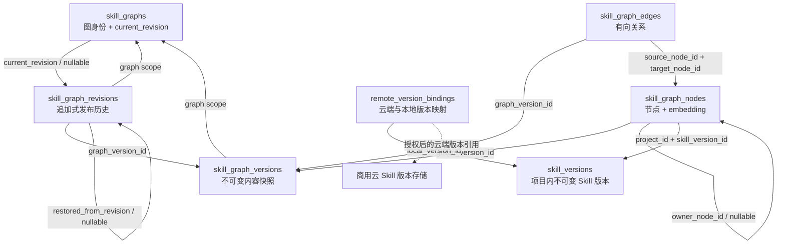
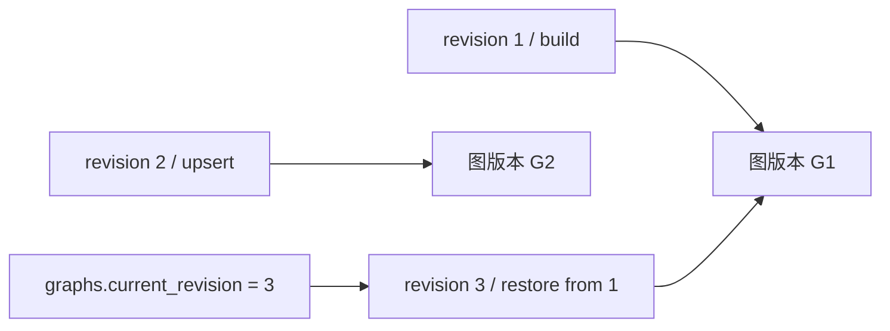

# Skill 图存储：项目隔离与历史回溯数据结构审查稿

- 状态：第一版表定义与注册已落地；算法执行、封存、发布、RLS 和恢复流程仍为待实现契约，不代表表注册已提供这些能力。
- 范围：共享 PostgreSQL + pgvector，五张图业务表；Python 执行构图、PPR 和重排。
- 原则：共享表按 project_id 隔离 Skill 数据，节点与向量合表，独立计算，发布使用短事务与 expected_revision；图版本保存内容，revision 保存发布历史。
- 不包含：审计日志、LLM 调用日志、项目成员与认证表；不修改商用 mindmemos 的 Skill 表。

## 1. 当前算法究竟构建几张图

旧入口 `SkillManageBuildRequest` 要求 `project_id`、`graph_id` 和 `version_refs`，`build_mode` 只接受 `full`。服务创建一个 `SkillManageScope`，算法将此次请求的全部文档解析成节点，在这组节点之间连边，返回一个 `SkillManageBuildPlan`。

**一次 full build 面向一个指定 graph_id，持久化成功后发布一个图版本。没有自动聚类后创建多个 graph_id 的逻辑。** full build 的成员集合来自本次完整输入，不应理解为往旧图追加一批 Skill。

- 一张图可以不连通。几个互不连通的分量仍属于同一张图的同一图版本。
- 调用方可以为不同 Skill 集合指定不同 graph_id。算法没有自动决定集合的策略。
- 同一 Skill 可以出现在多张图中，各图可选择不同版本；它们的发布和更新互不联动。
- 同一图的一份图版本中，同一 Skill family 只允许一个版本。旧请求校验器已检查该规则。
- 默认构图仅形成 Skill 节点和确定性 dependency 边；Scene 辅助函数、LLM 连边和多模式检索的声明不能等同于已完整接入。
- 构图入口不是 evolve：它索引已有 Skill 内容，不负责演化出新的 Skill 文档。

示例（以下 ID 为说明性名称）：

| 调用 | 指定的图 | 输入版本 | 结果 |
| --- | --- | --- | --- |
| build A | data-analysis | read@v1、clean@v2、stats@v1 | 图 A 的一份完整快照 |
| build B | reporting | read@v1、chart@v3、slides@v2 | 图 B 的一份完整快照 |
| 再次 full build A | data-analysis | read@v1、stats@v2 | 图 A 新快照只含这两个 Skill，旧快照仍保留 |

旧源码依据（路径以本机 checkout 为准）：

- [请求字段与一图一版本约束](/Users/cuiyuqi/hw-project/MindMemOs-fastapi/mindscale-noah/MindMemOS2.0_SKILL_Dev/mindmemos-skill/src/mindmemos_skill/mindmemos_skill/application/skill_manage/models.py:40)
- [单 scope 构建入口](/Users/cuiyuqi/hw-project/MindMemOs-fastapi/mindscale-noah/MindMemOS2.0_SKILL_Dev/mindmemos-skill/src/mindmemos_skill/mindmemos_skill/application/skill_manage/service.py:316)
- [单 plan 构图逻辑](/Users/cuiyuqi/hw-project/MindMemOs-fastapi/mindscale-noah/MindMemOS2.0_SKILL_Dev/mindmemos-skill/src/mindmemos_skill/mindmemos_skill/algos/skill_manage/algorithm.py:102)

## 2. 全局约定

### 2.1 Scope、身份和类型

- `S = (project_id, graph_id)`；下文 PK/FK/UNIQUE 中使用 S 是约束说明的缩写，实际 DDL 必须展开这两个物理列。每张表下方完整列出两个字段。
- `project_id` 是 Skill 数据的唯一隔离边界，须在此服务内全局唯一；`graph_id` 只区分项目内的逻辑图。Skill 属于项目，不按用户或记忆角色再分区。
- 用户或服务主体是操作者；认证系统校验其项目访问权限，并提供可信的 project 上下文。`actor_id` 仅记录操作发起者，不进入数据主键、隔离条件或图归属。
- 同项目内不同用户按项目权限共享 Skill；不同项目不得仅凭相同 Skill/version ID 访问彼此数据。宿主若另有租户模型，应在接入层映射到全局唯一 project_id，不向本模块引入第二层租户字段。
- 外部身份使用 `TEXT`，不强制商用云 ID 转 UUID；内部 graph_version/edge 身份使用应用生成的 `UUID`，无需引入额外 UUID 数据库扩展。
- `TIMESTAMPTZ` 表示绝对时刻，应用输入输出统一 UTC；租约有效性使用数据库时钟。
- `TEXT` 状态使用 CHECK 约束，不使用 PostgreSQL ENUM，以便状态演进。
- 所有身份字符串非空；hash 为小写 SHA-256 十六进制 `TEXT`，CHECK 长度与格式；规范化序列化算法须版本化。
- JSONB 对象默认 `{}` 的字段必须 CHECK 为 object；数组使用 `TEXT[]`，默认空数组且禁止 NULL 元素。禁止把密码、API key 或临时凭证写入 JSON。
- SQL 默认时间使用数据库时间；`updated_at` 由写入逻辑更新，DEFAULT 不会自动随 UPDATE 改变。
- 表格中的“约束/默认”属于实现要求。PostgreSQL 使用 JSONB、TEXT[]、vector；SQLite 分别使用 JSON、JSON 数组和 float32 BLOB；记录类型保持一致。标为“服务校验”的跨行语义不能冒充单行 CHECK 已经保证。

### 2.2 三种版本身份

| 名称 | 含义 | 变化规则 |
| --- | --- | --- |
| skill_version_id | 统一的本地 Skill 不可变版本引用 | 对应 skill_versions.version_id；云端 ID 由 remote 映射保留 |
| graph_version_id | 一份完整图内容，包含节点、边与向量 | 新内容生成新 ID，ready 后不可改写 |
| revision | 一次成功发布的序号，仅在 S 内有意义 | 从 1 开始单调递增，回滚也递增 |

尚未首次发布时 `graphs.current_revision = NULL`；API 用 `expected_revision = 0` 表示预期尚未发布。每个首次成功的写请求均新增 revision；内容未变化时复用已有图版本，仍记录一次发布确认。同一幂等键的成功重试返回原 revision，不新增发布。

## 3. skill_graphs：图身份与当前发布指针

一行对应一张逻辑图；不在这里保存节点、构图配置、embedding profile 或租约。第一版不实现公共锁表或长任务租约，范围见 [第一版并发与恢复边界](resource_coordination_design.md)。

| 变量名 | 存储类型 | 物理含义 | 用途 | 约束/默认 |
| --- | --- | --- | --- | --- |
| project_id | TEXT | 服务内全局唯一的项目标识 | 项目归属与权限校验 | NOT NULL；PK 部分 |
| graph_id | TEXT | 项目内稳定的逻辑图标识 | 寻址图、协调并发 | NOT NULL；PK 部分 |
| name | TEXT | 图的可读名称 | 管理界面展示；新图默认与 alias 相同 | NOT NULL；历史值保留 |
| alias | TEXT | 用户指定的图名及稳定查找键 | organize 定位逻辑图，graph-resolve/recommend 按名称解析 | NOT NULL；项目内唯一 |
| description | TEXT | 图用途说明 | 解释此图的 Skill 集合用途 | NULL 允许 |
| current_revision | BIGINT | 当前对外发布的 revision | 查找当前图版本 | NULL 表示尚未发布；非空时 > 0 |
| created_at | TIMESTAMPTZ | 图身份创建时间 | 管理与排序 | NOT NULL DEFAULT CURRENT_TIMESTAMP |
| updated_at | TIMESTAMPTZ | 图记录最近修改时间 | 管理元数据；不能替代 revision | NOT NULL DEFAULT CURRENT_TIMESTAMP |

约束与索引：

- PK：`S`；UNIQUE：`(project_id, alias)`，由数据库约束并发创建时不出现重名图。
- 服务写入前还需拒绝 alias 与项目内另一图的完整 graph_id 相同，以免精确引用同时指向两张图；历史冲突由解析接口返回歧义错误。
- FK：`(S, current_revision) → skill_graph_revisions(S, revision)`，允许 NULL。
- current_revision 只通过锁住 graph 行的短发布事务修改。初始化图不依赖图版本已存在。
- INDEX：`(project_id, updated_at)`。
- 暂不设计图删除 API；禁止普通调用硬删有历史的图。

已部署库升级时，先新增可空 alias 列及 `(project_id, alias)` 唯一索引，再部署兼容读写：新写入同时保存 alias，旧写入暂可保持 NULL，读取旧图时用稳定回填规则解析。随后为旧图按稳定的 `(project_id, graph_id)` 顺序回填：名称在项目内唯一且不与现有 alias 冲突时沿用 `name`，重名或冲突时以 `graph_id` 派生唯一 alias，原 `name` 不改。全部旧写入方退出且再次回填后，才改为非空。每步须可重复、中断后可恢复，并兼容过渡期的新旧服务；已有 graph_id、revision 和历史引用保持不变。

## 4. skill_graph_versions：不可变内容快照

一行对应一次 full build 或 mutation 尝试的产物。回滚复用旧图版本，不创建内容副本。本表记录图内容快照及其生命周期，通过 metadata 保存算法版本、实际生效配置等构建信息，不增加对应的独立列；不记录操作归属、尝试编号或构建基线。节点、边只在 staging 时写入。

| 变量名 | 存储类型 | 物理含义 | 用途 | 约束/默认 |
| --- | --- | --- | --- | --- |
| project_id | TEXT | 快照所属项目标识 | 隔离与复合关联 | NOT NULL；PK 部分 |
| graph_id | TEXT | 快照所属图标识 | 防止快照跨图发布 | NOT NULL；PK 部分 |
| graph_version_id | UUID | 此份快照的不可变身份 | 定位所有节点、边和向量 | NOT NULL；PK 部分 |
| status | TEXT | 内容构建阶段 | 控制可写性、发布资格 | NOT NULL DEFAULT 'staging'；staging/validating/ready/failed |
| node_count | BIGINT | 校验后的节点总数 | 完整性检查 | NULL 直到 ready；非空时 >= 0 |
| edge_count | BIGINT | 校验后的边总数 | 完整性检查 | NULL 直到 ready；非空时 >= 0 |
| vector_count | BIGINT | 校验后的非空向量总数 | 核对需要 embedding 的节点覆盖 | NULL 直到 ready；0 <= vector_count <= node_count |
| snapshot_hash | TEXT | 按统一规范计算的图内容摘要 | 比较内容、检测意外变更 | NULL 直到 ready；覆盖排序后的节点、边和向量内容，不包含构建配置 |
| metadata | JSONB | 此图版本的算法身份、版本、配置等构建元数据 | 解释构建过程、核对配置及支持历史检索 | NOT NULL DEFAULT '{}'；CHECK 为 object；不含凭证 |
| created_at | TIMESTAMPTZ | 候选快照建立时间 | 候选定位与排序 | NOT NULL DEFAULT CURRENT_TIMESTAMP |
| ready_at | TIMESTAMPTZ | 封存校验成功的时刻 | 确认何时成为可发布内容 | ready 时必须非空；之后保留 |

约束与索引：

- PK：`(S, graph_version_id)`。
- FK：S → graphs；本表不记录构建基线。
- 失败后重新构建使用新图版本，不覆盖或接管旧候选；每次执行尝试使用独立 graph_version_id，仅创建者写入其候选；重试使用新候选，不自动接管旧候选。第一版没有候选自动 GC。
- ready 必须有 ready_at、三个计数和 snapshot_hash；此后图内容与 metadata 均不可修改。
- 图版本不保存 active/retired：当前性只由 graphs.current_revision 决定；旧图版本可能被再次发布。
- INDEX：`(S, status, created_at)`。
- 校验输入必须封存：staging → validating 时停止所有批次写入，校验后转 ready。
- snapshot_hash 校验排序后的节点业务字段、边和向量字节；排除承载快照的 project_id、graph_id、graph_version_id 物理分区列，不排除 node_id、skill_version_id 或边端点等逻辑身份。包含节点和边自身的 metadata，但不包含图版本的构建 metadata；比较构建配置时需单独比较图版本 metadata。
- metadata 在 staging 阶段由构建服务记录实际生效参数，封存后不可改写；不是随时可修改的备注。不得通过 metadata 隐式恢复已删除的操作归属、尝试编号或构建基线字段。

### 4.1 metadata 建议内容

以下为 JSON 内的建议键，不是新增 SQL 列。算法身份与配置由构建服务填写；embedding 信息在生成向量时记录。存储允许空对象，但缺少相关配置时不能据此承诺历史算法重建或向量空间兼容性。

| 变量名 | 存储类型 | 物理含义 | 用途 |
| --- | --- | --- | --- |
| metadata.algorithm_name | JSON string | 构图算法注册名称 | 定位构建实现 |
| metadata.algorithm_version | JSON string | 实际执行的算法版本 | 解释不同版本的算法行为 |
| metadata.algorithm_config | JSON object | 本次实际生效的非敏感算法参数 | 查看和比较构建设置；按对应算法模型校验 |
| metadata.embedding_profile | JSON object | 本图版本实际使用的向量生成配置 | 历史检索及向量复用校验 |
| metadata.embedding_profile.model | JSON string | 稳定的模型或部署版本身份 | 确定向量空间，不存 API key 或临时凭证 |
| metadata.embedding_profile.dimension | JSON integer | 向量坐标数 | 校验节点与查询向量的形状 |
| metadata.embedding_profile.template_version | JSON string | 节点转 embedding 文本的模板版本 | 校验复用输入语义 |
| metadata.embedding_profile.normalization | JSON string | embedding 文本规范化规则 | 固定文本处理方式，不表示向量单位化 |

算法配置字段随算法定义，不要求所有算法拥有同一组参数。metadata 中的配置是实际产物的描述；规范化请求只参与幂等摘要计算，不作为可恢复任务持久化。

## 5. skill_graph_nodes：节点、检索特征与向量

一行对应图版本内一个节点。第一版默认算法只生产 skill 节点；scene 结构用于明确未来边界，不代表当前已实现 Scene 构图。没有单独 membership、embedding 或 mapping 表。

| 变量名 | 存储类型 | 物理含义 | 用途 | 约束/默认 |
| --- | --- | --- | --- | --- |
| project_id | TEXT | 节点所属项目 | 隔离与复合关联 | NOT NULL；PK 部分 |
| graph_id | TEXT | 节点所属逻辑图 | 防止跨图关联 | NOT NULL；PK 部分 |
| graph_version_id | UUID | 节点所属内容快照 | 固定版本读取 | NOT NULL；PK 部分；FK |
| node_id | TEXT | 图内稳定的逻辑节点身份 | 跨图版本比较和边端点引用 | NOT NULL；PK 部分；不使用名称作为身份 |
| node_type | TEXT | 节点类别 | 区分 Skill 与细粒度场景 | NOT NULL；skill/scene |
| skill_version_id | TEXT | 构图使用的本地 Skill 不可变版本标识 | 关联原文、Skill 归属与来源映射 | skill 节点必填；scene 为空；项目范围 FK |
| owner_node_id | TEXT | 同一快照内所属 Skill 节点 ID | Scene 归属及级联逻辑 | skill 时为空；scene 时必填；同快照 FK |
| name | TEXT | 节点展示名称 | 展示与规则重排 | NOT NULL；允许不同 Skill 同名 |
| description | TEXT | 节点能力描述 | embedding 与重排 | NOT NULL DEFAULT '' |
| one_line_capability | TEXT | 简短能力陈述 | embedding 与重排 | NOT NULL DEFAULT '' |
| inputs | TEXT[] | Skill 所需输入描述列表 | 确定性依赖连边 | NOT NULL；记录模型默认空列表 |
| outputs | TEXT[] | Skill 产出描述列表 | 确定性依赖连边 | NOT NULL；记录模型默认空列表 |
| domain_tags | TEXT[] | 领域标签列表 | 检索重排 | NOT NULL；记录模型默认空列表 |
| tooling | TEXT[] | 工具及依赖相关关键词列表 | 检索特征；不作为权限或安装指令 | NOT NULL；记录模型默认空列表 |
| example_tasks | TEXT[] | 显式示例任务描述列表 | embedding 与重排 | NOT NULL；记录模型默认空列表 |
| rendered_snippet | TEXT | 文档展示及 embedding 用的摘要片段 | 避免检索时重新解析 | NOT NULL DEFAULT ''；不是完整原文备份 |
| metadata | JSONB | 非核心的节点扩展属性 | Scene 标识等算法扩展 | NOT NULL DEFAULT '{}'；禁止重复 node_id、scope 等独立列 |
| embedding | vector | 节点的 float32 向量 | cosine 召回，与节点一起持久化 | NULL 允许；使用不固定维度的 pgvector 类型 |
| embedding_input_hash | TEXT | 实际 embedding 输入文本的摘要 | profile 相同时复用向量 | 与 embedding 同空或同非空；摘要对象是实际 embedding 输入 |

约束与索引：

- PK：`(S, graph_version_id, node_id)`。
- FK：`(S, graph_version_id)` → skill_graph_versions。
- FK：`(S, graph_version_id, owner_node_id)` → nodes；允许 NULL；校验 owner 必须为 skill，禁止自己拥有自己。
- FK：`(project_id, skill_version_id)` → `skill_versions(project_id, version_id)`；目标需建立对应唯一约束。
- 部分 UNIQUE：`(S, graph_version_id, skill_version_id) WHERE node_type = 'skill'`，防止同一版本重复成为 Skill 节点。一个 family 只能选择一个版本：封存后关联 skill_versions 按 skill_id 检查，拒绝同一 family 的多个版本，通过后才能 ready；该规则不能仅由上述唯一索引保证。
- skill 节点 skill_version_id 非空、owner 为空；scene 的 skill_version_id 为空、owner 非空，由 owner 找到版本引用。
- 当前默认算法 ready 时每个 skill 节点必须有向量；scene 暂不要求向量。其它算法按声明的 embedding 覆盖契约校验。
- 记录校验：embedding 非空时向量有限且非零，转换为 float32；该验证由记录模型和 infra 向量编解码执行，不声明通用 SQL CHECK 已覆盖所有后端。写入/封存服务根据实际生效配置校验向量维度，并检查同一图版本内维度一致；metadata.embedding_profile.dimension 存在时必须与实际向量维度一致。维度相同不能证明模型或向量空间相同。
- 第一版用 scope B-tree 过滤后精确向量搜索；不要直接对混合维度列建立通用 ANN 索引。后续按 profile/维度分组选择表达式索引或分区，并测试过滤后的召回率。
- infra.Vector 支持不固定维度的声明；同一图版本内的维度一致性仍需封存服务校验，表定义不跨行推断模型兼容性。
- 节点统一引用本地 skill_versions；云端版本先经 remote_version_bindings 映射为本地不可变版本，云端 ID 保留在映射表中，不写入节点作为本地版本 ID。Skill 身份、来源与原文摘要通过版本表及 remote 映射查询，不在节点或节点 metadata 重复存储。
- 被引用版本的内容、Skill 归属与项目归属必须不可变，更新新增版本，禁止覆盖旧版本；版本表维护内容摘要，并保留原文与执行资源。解析特征、摘要片段和向量属于本次构图产物，封存后固定，不随 Skill 新版本同步更新。node_id 保留跨图版本稳定的逻辑身份，不以 skill_version_id 代替。

## 6. skill_graph_edges：快照内有向边

| 变量名 | 存储类型 | 物理含义 | 用途 | 约束/默认 |
| --- | --- | --- | --- | --- |
| project_id | TEXT | 边所属项目 | 隔离与复合关联 | NOT NULL；PK 部分 |
| graph_id | TEXT | 边所属图 | 防止跨图连接 | NOT NULL；PK 部分 |
| graph_version_id | UUID | 边所属快照 | 固定版本拓扑 | NOT NULL；PK 部分 |
| edge_id | UUID | 边的稳定逻辑身份 | 跨快照 diff 与定位 | NOT NULL；PK 部分；由端点及类型确定性生成 |
| source_node_id | TEXT | 有向边起点 ID | 出边查询、PPR | NOT NULL；同快照 FK |
| target_node_id | TEXT | 有向边终点 ID | 入边查询、PPR | NOT NULL；同快照 FK |
| edge_type | TEXT | 关系语义类型 | 控制解释与图传播权重 | NOT NULL；dependency/containment/flow/semantic/workflow/alternative |
| weight | DOUBLE PRECISION | 非负关系强度 | 构造图转移矩阵 | NOT NULL DEFAULT 1；有限且 >= 0 |
| metadata | JSONB | 匹配证据等扩展信息 | 解释边的来源 | NOT NULL DEFAULT '{}'；不重复独立列 |

约束与索引：

- PK：`(S, graph_version_id, edge_id)`。
- UNIQUE：`(S, graph_version_id, source_node_id, target_node_id, edge_type)`；同类型平行边合并证据，第一版不存多份。
- 两个 FK 分别为 `(S, graph_version_id, source_node_id/target_node_id)` → nodes；可同时声明图版本 FK。
- CHECK：source_node_id != target_node_id；算法需要的无出边自循环在内存计算，不写成业务关系。
- INDEX：`(S, graph_version_id, source_node_id)` 和 `(S, graph_version_id, target_node_id)`。
- 端点/类型改变视为另一条边；权重变化保留逻辑 edge_id。不能用遍历序号生成稳定边身份。
- 当前默认算法只生成 dependency；其它类型是契约允许值，不代表已接入生成路径。

## 7. skill_graph_revisions：追加式发布历史

一行表示一次成功发布。历史读取通过 revision 找到图版本；回滚插入新 revision 并复用旧图版本。此表为业务历史，不是可随意清理的审计日志。

| 变量名 | 存储类型 | 物理含义 | 用途 | 约束/默认 |
| --- | --- | --- | --- | --- |
| project_id | TEXT | 发布所属项目 | 隔离与复合关联 | NOT NULL；PK 部分 |
| graph_id | TEXT | 发布所属逻辑图 | 确定 revision 的编号范围 | NOT NULL；PK 部分 |
| revision | BIGINT | 此图第几次成功发布 | 乐观并发检查和历史定位 | NOT NULL；PK 部分；> 0；在 graph 行锁内分配 |
| graph_version_id | UUID | 这次发布采用的完整内容 ID | 读取/恢复历史快照 | NOT NULL；同图 FK |
| idempotency_key | TEXT | 调用方为一次写请求生成的稳定重试标识 | 成功重试定位原发布结果 | NOT NULL；非空；同图 UNIQUE |
| request_hash | TEXT | 规范化写请求的 SHA-256 摘要 | 拒绝成功幂等键被用于不同请求 | NOT NULL；64 位小写十六进制；摘要输入包含请求契约版本 |
| action | TEXT | 此次发布的业务动作 | 区分构建、更新、移除和回滚 | NOT NULL；build/upsert/remove/restore |
| restored_from_revision | BIGINT | restore 指定的历史发布号 | 解释回滚来源 | restore 时必填，其它 action 必须 NULL；同图 FK |
| actor_id | TEXT | 发起操作的用户或服务主体标识 | 展示发布责任主体，不参与数据隔离 | NOT NULL；来自认证上下文 |
| message | TEXT | 发布说明 | 人工理解变更原因 | NULL 允许 |
| published_at | TIMESTAMPTZ | 发布记录写入的数据库时间 | 历史排序与展示 | NOT NULL DEFAULT CURRENT_TIMESTAMP |

约束与索引：

- PK：`(S, revision)`；UNIQUE：`(S, idempotency_key)`，在数据库层阻止同键重复发布。
- FK：S → graphs；`(S, graph_version_id)` → skill_graph_versions；`(S, restored_from_revision)` → revisions。
- restore 时目标 revision < 本 revision，且 graph_version_id 必须等于目标 revision 的 graph_version_id；后者在发布事务内校验。
- revision=1 为首次发布；每次发布取 current_revision+1。不是图版本次数，也不是 Skill 版本号。
- INDEX：`(S, graph_version_id)`，用于判断内容是否被任何历史引用。
- revision 行发布后禁止 UPDATE/DELETE。新请求即使内容相同也新增 revision，复用既有 graph_version_id，不复制节点、边或向量；同键重试直接返回原记录。成功响应固定为本行的 revision、graph_version_id、action 与 published_at，不依赖易变的当前指针。
- graphs 只保存 current_revision；当前 graph_version_id 通过此表读取，避免保存两个可矛盾的当前指针。

## 8. 不增加表的幂等机制

成功幂等由 revisions 的 `(S, idempotency_key)` 唯一约束和 request_hash 保证；不同执行尝试独立构建不同候选；发布时锁 graph 行并检查 expected_revision。第一版不使用长任务租约或公共锁表。没有独立操作表，也不把任务状态、请求正文、错误历史搬进 JSON。

### 8.1 请求契约（API 字段，不是新增数据库列）

图写入层的调用方在首次发送前生成并保存 idempotency_key；超时或断线重试使用相同 key 和完整请求。服务不能每次收到请求都替调用方生成新 key。所有图写入动作在进入写入层前必须确定 expected_revision：0 表示尚未发布，否则为受理时读取到的当前 revision，不允许在发布前重新读取并覆盖较新状态。面向普通用户的异步 `organize` HTTP 接口由服务端捕获并持久保存该值，不要求用户填写；内部写入层仍须显式提供。

| 变量名 | 存储类型 | 物理含义 | 用途 | 适用范围 |
| --- | --- | --- | --- | --- |
| idempotency_key | API string | 本次写请求的重试身份 | 成功后落入 revisions | 全部写动作；同图唯一 |
| expected_revision | API integer | 调用方预期的当前发布号 | 接受和提交时校验；防止陈旧写入 | 全部写动作；>= 0 |
| action | API string | 请求执行的业务动作 | 分派算法或回滚 | build/upsert/remove/restore |
| request_contract | API string | 不可变的请求契约与规范化规则版本 | 保证升级后仍能比较历史请求 | 全部写动作；如 graph-write-v1 |
| version_refs | JSON array | 明确选择的 Skill 版本列表 | 完整确定构图成员 | build 必填；upsert 恰好一个元素 |
| version_refs[].skill_version_id | JSON string | 本地不可变版本身份 | 查询 Skill 归属并读取准确内容 | build/upsert |
| algorithm_name | JSON string | 请求选择的算法 | 恢复时定位实现 | build/upsert/remove |
| algorithm_version | JSON string | 固定算法版本 | 不让重试静默换算法 | build/upsert/remove |
| algorithm_config | JSON object | 生效的算法参数 | 恢复相同计算配置 | build/upsert/remove；按对应配置模型逐字段校验 |
| embedding_profile | JSON object | 固定的向量生成配置 | 复用与重新计算 | build/upsert/remove |
| embedding_profile.model | JSON string | 稳定模型部署版本 | 匹配向量空间 | 同上 |
| embedding_profile.dimension | JSON integer | 向量维度 | 校验形状 | 同上 |
| embedding_profile.template_version | JSON string | 输入文本模板版本 | 固定输入语义 | 同上 |
| embedding_profile.normalization | JSON string | 文本规范化方式 | 固定文本处理 | 同上 |
| selector | JSON object | 从图移除的对象 | 确定 remove 范围 | remove 必填 |
| selector.skill_id | JSON string | 待移除的本地 Skill family | 通过版本表定位成员；属于操作选择条件 | remove |
| selector.skill_version_id | JSON string or null | 可选精确版本限制 | 非空时仅移除匹配版本 | remove |
| target_revision | JSON integer | 待恢复历史发布号 | 定位 restore 内容 | restore 必填；> 0 |
| message | JSON string or null | 请求者发布说明 | 成功时复制到 revision | 全部动作 |

以上输入先校验项目授权和请求类型并计算摘要，优先查询成功幂等结果；仅在未命中时继续校验 Skill 版本归属、存在性和当前算法可用性。actor_id 来自认证上下文。graph scope 来自路由，不允许正文覆盖。

request_hash = SHA-256(规范化的 request_contract、S、actor_id、action、expected_revision 和完整业务输入)。规范化采用明确且版本化的 JSON 规则：键排序、固定数字表示、明确 NULL 与省略的语义，数组仅在契约明确无序时排序。算法、模型和模板必须固定版本；默认配置由不可变 request_contract 定义，升级默认值必须新建契约版本，不能让同一历史请求因部署变化产生另一份摘要。服务需保留旧契约解析能力，不能默默按新默认值重解释重试。

只存 SHA-256，不存完整请求正文，因此一致性判断依赖抗碰撞假设，不声称逐字正文比较。请求失败且尚未产生 revision 时不建立永久 key 绑定；调用方仍应保持相同 key 对应相同请求。必须改变输入或 expected_revision 时使用新 key。

### 8.2 成功重放、执行失败与 no-op

- 请求通过认证和规范化后，先查 `(S, idempotency_key)`：存在且 hash 一致，返回该条历史发布结果；hash 不同返回幂等冲突。此查询优先于当前 revision 检查和当前业务可执行性检查，因此后续图更新或配置停用不会让已成功请求重新执行。
- 未成功的重复请求可能独立计算，每次使用新候选 ID；最终依靠发布事务与幂等唯一约束保证不重复发布。第一版不提供运行任务查询、合并或排队。
- 请求失败不保留任务记录或错误结果。崩溃后调用方重发完整请求，使用新的候选 ID 重新构建；不保证后台自动恢复，不保证 LLM/embedding 只调用一次，只保证同一 key 至多产生一次已提交发布。
- 提交结果不明时先查 revision，再按同一请求重试。事务提交前崩溃不留下半条发布；提交后响应丢失可通过 key 找回结果。
- 不再采用“新 key 的 no-op 不写任何记录”规则：它无法在不保存其它幂等记录的情况下可靠重放历史结果。新 key 的内容未变请求也新增发布 revision，但复用原图版本。是否内容一致须同时核对内容摘要与构建 metadata；restore 直接复用目标图版本。未发布图必须先 build，不能凭空确认 no-op。
- 同键成功结果随 revision 长期保留，默认不设独立 TTL；删除发布历史会同时失去对应幂等保证。重放是返回原结果，不是把当前图切回旧 revision。

## 9. 表间依赖关系（Mermaid）

图中的 scope 均为 `(project_id, graph_id)`；不含用户或租户身份。箭头由引用方指向被引用方。实线表示本方案要求的 SQL FK；虚线表示需服务校验的外部引用，不表示 SQL FK。每条图内 FK 都带完整 S；节点关联还带 graph_version_id。

存在有意的循环 FK：先创建表，再补充命名外键。创建图时 current_revision 为空；先完成图版本，再在发布事务插入 revision 并更新 current_revision。所有历史 FK 默认 ON DELETE RESTRICT，不用级联删除抹掉历史。

回溯示例：

## 10. 第一版并发写入与原子发布

1. 认证、规范化请求，先查询已成功幂等结果。命中且摘要一致则返回原结果，摘要不同则冲突。
2. 未命中时检查 expected_revision 并固定输入版本。每次执行创建独立 graph_version_id，在内存或独立目录计算；不锁输入 Skill，不持有长任务锁。
3. 候选仅由创建它的执行流程写入；一个候选的批次写入需由该流程串行安排，封存前等待全部批次完成。重试和文件恢复创建新候选 ID，不接管旧候选，也不开放任意候选写入 API。
4. 分批写入只允许 staging；staging → validating 后不再写节点或边。校验引用、Skill family 唯一性、向量覆盖、维度及内容摘要，通过后 ready。封存后的内容与配置不可变；这些状态和跨行规则由后续服务实施，不能只凭表定义保证。
5. 发布使用一个短数据库事务。PostgreSQL 锁 graph 行；SQLite 对应显式短写事务。锁后再次查询幂等键：命中则重放；未命中则验证 expected_revision 与 COALESCE(current_revision, 0) 相等、目标图版本属于该图且 ready。插入下一 revision、更新 current_revision 后一次提交。
6. 幂等查询优先于预期版本校验；同 key 成功重试不因当前图已更新而失败。唯一冲突先回滚，再读取已有记录并核对请求摘要。事务失败不能留下半条发布。
7. 新 key 的无内容变化请求仍新增 revision，复用已有内容。restore 同样锁图、验证 expected_revision 与目标历史引用并新增 revision，不复制内容。
8. revision 冲突时保留候选并返回冲突，不自动重算或覆盖最新图。第一版不自动 GC、不做后台接管；失败候选留待显式管理。

模型和环境调用都在事务外。短事务只保证当前指针不被陈旧结果覆盖；计算可以重复，外部调用不保证只执行一次。暂不实现 resource_locks、lease、heartbeat、fencing、预算预留、任务合并或分布式并发配额。

## 11. 项目隔离与历史读取

- 一套共享表、一组按进程配置的有界连接池，不给每个用户创建数据库或连接池。
- 云服务上线前需为五张图表启用 RLS；project_id 条件同时用于 USING 和 WITH CHECK。应用角色不持有 SUPERUSER/BYPASSRLS，不依赖默认会绕过策略的所有者权限；必要时 FORCE ROW LEVEL SECURITY。
- 认证后在每个事务中用参数化 `set_config('app.project_id', ..., true)` 设置事务局部上下文；缺少上下文时策略拒绝访问。不能允许不可信调用者直接使用应用数据库连接或自行设置项目上下文。
- RLS 负责项目边界；接入层校验操作者是否有该项目的读写权限。graph_id 是项目内组织维度，不默认再引入用户、角色或图成员隔离。
- 查询缓存键带 project/graph/graph_version 和检索配置身份；查询结果缓存还带 query、top_k、mode 等输入。
- 历史查询用 revision 固定图版本。历史向量检索使用 metadata.embedding_profile 中记录的配置；若缺失，则必须由调用方或配置管理明确提供兼容配置，无法确认时不承诺可用。图结构读取和发布指针回滚不依赖重新生成向量。
- 需要跨多条 SELECT 一致读取时使用短的 READ ONLY REPEATABLE READ 事务；PostgreSQL 默认 READ COMMITTED 不能保证多条查询使用同一快照。数据物化后退出事务，再运行 PPR；模型调用在事务外。
- PPR 使用 node_id 和稀疏邻接结构；旧算法用 name 建索引，迁移时需要修正同名节点混淆。
- ANN 是后续性能优化，不作为数据正确性前提。先按 scope/graph_version 精确查询，性能结论用实际图规模和维度测量。

## 12. 保留、恢复与来源兼容性

- 所有已发布 revision 及其引用的图版本默认保留，不自动只保留最近两版。
- 第一版不提供候选自动 GC。失败或未发布候选保留；未来增加清理时，必须先定义如何确认没有运行中的写入与发布，不根据 created_at 单独推断可删除。
- 普通业务不删除 revision；内容被引用时 FK RESTRICT 阻止删除。需要合规删除项目或历史保留上限时另定义显式管理流程，不伪装成日常 GC。
- graph 回溯不是原始 Skill 文档备份：来源存储必须保留准确版本与执行资源。若版本不再可用，图结构仍可查看，但不能保证执行恢复；部署前应落实来源保留契约。
- 本地 skill_versions 增加必填 project_id 与 (project_id, version_id) 唯一约束，节点通过复合外键引用；旧数据迁移必须显式补齐所属项目，不能使用默认项目掩盖缺失。版本内容及归属不可变、历史保留和查询授权由后续服务落实。云端项目与本地项目的映射在 remote 接入层明确，不假定两边字符串天然相等。本方案统一引用本地版本，不支持节点直接引用未映射的云端版本。本轮实现本地表定义与注册，不执行已有数据库迁移，不修改商用 mindmemos 云表。
- 图版本通过 metadata 保存算法和向量配置，不新增对应独立列。元数据不能保证历史代码、模型和执行环境仍可用，因而不承诺重新构建结果逐位一致；结构与摘要规范变化仍通过显式迁移处理。
- 幂等结果保存在发布记录；图版本描述内容。成功重放不依赖运行中的进程，进程重启不会抹掉已成功请求的结果。

## 13. 实施边界与审查重点

图业务表和发布协议归属 `persistence/db_services/skill_management/`；第一版不创建 coordination 服务或 resource_locks 表。顶层 persistence 负责工厂与 schema 注册，infra 提供连接/事务/向量基础操作。schema migration 使用显式迁移步骤；ensure_collection 只创建缺失结构，不能代替演进已有表。

落地前需确认：

1. 五张图表的 scope、字段名、可空语义及约束是否符合产品模型。
2. 一个 Skill family 一个版本的规则，以及 metadata 的算法配置与 embedding profile 契约、缺失时的处理方式。
3. 是否接受全部发布历史默认保留，以及原始 Skill 版本的保留契约。
4. 商用云来源与本地来源的项目授权如何接入；表级项目引用落地不代表 API 查询授权与 RLS 已完成。
5. 接受“每个新 key 的成功写请求增加 revision、内容未变时复用图版本”的语义，以及仅成功结果持久化、失败由调用方重试的边界。
6. 不同图可复用同一 Skill 版本，但不自动同步更新；没有自动分组、跨图联动发布或分支 merge 功能。

表定义验证包括 SQLite 建表和读写、项目/图/版本复合外键、幂等键唯一性、图内边端点约束、字段校验及 PostgreSQL DDL 编译。发布服务实现后再验证真实并发、事务回滚、响应丢失重放、封存后拒绝写入、历史查询与 restore 竞争。当前表注册不等于这些业务流程已实现。

## 14. 官方技术依据

- [PostgreSQL Row Security Policies](https://www.postgresql.org/docs/current/ddl-rowsecurity.html)：项目行级隔离及数据库角色绕过规则。
- [PostgreSQL Transaction Isolation](https://www.postgresql.org/docs/current/transaction-iso.html)：READ COMMITTED 与 REPEATABLE READ 的快照边界。
- [PostgreSQL Explicit Locking](https://www.postgresql.org/docs/current/explicit-locking.html)：短事务行锁及并发写入互斥。
- [PostgreSQL Constraints](https://www.postgresql.org/docs/current/ddl-constraints.html)：复合唯一约束与外键。
- [pgvector](https://github.com/pgvector/pgvector)：向量类型、精确检索，以及混合维度列的索引要求。

以上来源支持数据库能力；图业务表的拆分、状态机和业务约束是本项目的设计提案。
