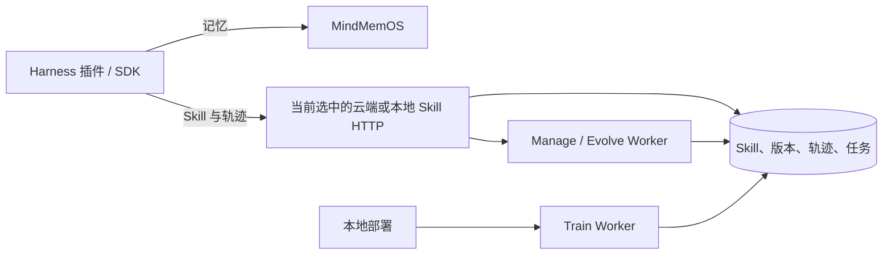

# MindMemOS 与 MindMemOS Skill 目标架构及 HTTP 接口

> 状态：目标设计稿，供接口评审和实施使用。以下路径及响应并不表示已经上线。

## 1. 服务边界

MindMemOS 负责记忆；MindMemOS Skill 负责 Skill 仓库、版本、Harness 轨迹、`skill_manage`、自演进，以及本地部署的训练。两个服务独立部署、独立持久化。Skill 服务可部署在云端或本地，客户端一次只连接其中一个 Skill 服务；两套仓库各自独立，不做端云同步或状态对照。Memory `add` 不再承担 Skill 轨迹或演进输入，Memory 侧不新增异步任务查询接口。

Skill Service 的**服务端公开业务能力**均提供 HTTP 入口。客户端文件导出由 SDK 调用完整信息 HTTP 接口后在调用方机器上完成，服务端不接收导出目录，也不提供导出 HTTP 接口。生命周期方法（初始化、关闭、后端实例）由进程管理；原始算法 span 和日志属于内部可观测性，不设用户诊断接口。算法任务的业务状态统一通过任务接口读取。



## 2. 部署、身份与用户输入

### 2.1 部署能力

| 能力 | 云端 Skill 服务 | 本地 Skill 服务 |
| --- | --- | --- |
| Skill 注册、版本、完整信息查询、切换、删除 | 支持 HTTP | 支持 HTTP |
| Skill 写入调用方本地目录 | SDK 通过完整信息 HTTP 查询后在客户端完成 | SDK 通过完整信息 HTTP 查询后在客户端完成 |
| 轨迹上报与查询 | 支持 HTTP | 支持 HTTP |
| `skill_manage` 组织、推荐 | 支持 HTTP | 支持 HTTP |
| `evolve` 异步任务 | 支持 HTTP | 支持 HTTP |
| `train` 训练 | 不发布 HTTP 路由 | 通过本地 Python 服务入口调用；不发布 HTTP 路由 |

HTTP 服务只装配和运行 `skill_manage` 与 `evolve` 两类算法 pipeline；仓库 CRUD、轨迹和任务查询是业务接口，不算训练 pipeline。`skill_manage` 需要由服务编排层读取已注册的版本、构造算法输入并发布图快照；不能把裸算法对象直接当成已上线 HTTP 能力。`organize`、`recommend` 与 `evolve` 使用已认证 Project 绑定的对应 pipeline 配置，不接受请求级 `pipeline`。本地 Python 服务入口仍可配置并调用 `train`；训练不经过 FastAPI。缺少已配置 pipeline 的 HTTP 操作返回稳定的 `pipeline_unavailable`，不伪造成功结果。

统一 SDK 使用 `memory_url`、`skill_url` 两个可分别配置的地址；`skill_url` 只指向当前选择的云端或本地 Skill HTTP 服务。切换部署位置就是切换该地址，此后的注册、查询、版本、轨迹和任务操作都作用于新地址对应的仓库；既有 Skill/版本 ID 不自动迁移，也不默认跨仓库可用。本地双服务安装模板预填地址；单入口部署可按路径转发。SDK 和 Harness 插件负责读取本地 Skill 文本文件、构造 bundle JSON、计算源 hash、保存重试状态和本地 `auto_register` 设置，用户业务代码不需要维护两个底层 HTTP 客户端。

### 2.2 项目身份与字段来源

账号系统是 Project 的唯一身份和授权来源。Memory 与 Skill 各自验证凭据，解析到同一个 `project_id` 即共享逻辑 Project；两个服务不共享数据库或跨库事务。离线单项目部署从受保护的部署清单读取同一 `project_id`；多项目本地部署必须有可信项目身份机制。

| 信息 | 用户需要填写吗 | 补全者 | 规则 |
| --- | --- | --- | --- |
| `project_id` | 否 | 账号服务或本地部署清单 | 不接受请求体覆盖，所有查询和写入按项目隔离 |
| `skill_id`、`skill_version_id` | 创建时否 | Skill 服务 | 创建后返回；后续选择已有 Skill/版本时由用户或插件引用 |
| `trajectory_id`、`task_id` | 否 | Skill 服务 | 持久保存后返回 |
| `content_hash` | 否 | Harness 插件计算，服务端复算校验 | 只由源 bundle 计算；resources 不参与身份判断 |
| 本地 Skill 来源标识 | 否 | Harness 插件与 SDK | 仅用于本地维护来源到 `skill_id` 的映射，按当前 Skill 服务与已认证 Project 隔离，不作为 HTTP 字段 |
| 版本标签、父版本、执行目录、任务时间 | 注册与提交时 `version` 必填；其余通常否 | Skill 服务与 Worker | 注册和提交的版本标签取请求的 `version`；父版本、执行目录与时间由服务端补全 |
| `pipeline` | 否 | 服务端按已认证 Project 读取配置 | `organize`、`recommend`、`evolve` 不接受此请求字段；运行时固定所选配置版本 |
| 幂等重试标识 | 否 | SDK/插件内部生成并持久保存 | 不出现在普通用户方法签名；原生 HTTP 可选传 `Idempotency-Key` |

`user_id`、`agent_id` 和执行 `messages` 来自业务或 Harness 上下文，不由账号系统猜测。所有服务端补全字段都要在入库前确定并校验；仅客户端自报的 hash、名称或项目 ID 不能作为版本身份与授权依据。

**Skill 内容身份只看源 bundle hash。** 在同一 Project 内，相同 `content_hash` 代表相同的源 bundle 内容，但不同 Skill 家族或不同版本可以引用该内容；hash 本身不是 Skill/版本 ID。`resources` 可以作为运行所需辅助文件随版本保存，执行时仍可读取其内容；客户端不上传单独的 resources hash，服务端也不使用它解析版本。resources 差异不改变 bundle hash，但不同版本各自保留自己的 resources，不静默改写历史版本。跨 Project 仍各自隔离。

**Bundle 是唯一的算法可处理文本集合。** 注册、提交、SDK 自动注册流程与完整信息读取中的 bundle 使用同一结构：JSON 对象直接以规范化的相对路径为键、UTF-8 文本为值，必须包含非空 `SKILL.md`；版本解析接口提交的 hash 也从这种 bundle 计算。`SKILL.md` 保存 Skill 主体和 frontmatter；其他文本文件可作为额外算法输入。服务端校验路径不能为绝对路径、不能包含 `..`，统一文本换行，再把各文件按路径排序为 `{path, content}` 记录数组；记录对象的键按字典序排列，以 UTF-8、无多余空格且不转义非 ASCII 字符的规范 JSON 计算 SHA-256 `content_hash`。插件使用相同规则。任一 bundle 文本变化都会改变版本内容身份。`resources` 是单独保存的辅助文件，不属于 bundle，也不参与算法处理或 bundle hash。

### 2.3 通用 HTTP 约定

Skill 业务路径统一以 `/v1/skills` 开头，全部使用 `POST`；路径表达操作，业务变量放在 JSON 请求体中。路径和查询字符串不承载 Skill、版本、轨迹或任务 ID，也不承载筛选条件。成功包裹为 `{"code":"ok","request_id":"...","data":{...}}`，异步受理使用 `code: "accepted"`；错误包裹包含稳定 `error.code`、`error.message` 和 `request_id`。读取操作按已授权项目隔离，跨项目资源返回 `404`。

| 通用请求字段 | 类型 | 必填 | 来源/位置 | 说明 |
| --- | --- | --- | --- | --- |
| `Authorization` | string | 按部署 | HTTP header | 云端凭据；本地按部署的可信身份机制处理 |
| `Content-Type` | string | 是 | HTTP header | `application/json` |
| `Idempotency-Key` | string | 否 | SDK/插件；HTTP header | 写入或异步受理请求的重试标识，由 SDK/插件内部生成并保存 |

`400/422` 表示请求格式错误，`401/403` 表示身份或权限不足，`404` 表示项目内无资源，`409` 表示幂等或版本竞争，`429/503` 表示暂时不可用。服务端拒绝未知顶层字段。所有时间是带时区的 ISO 8601 字符串。直接使用 HTTP 的调用方不传幂等键也能提交请求，但网络超时后的无重复重试只由 SDK/插件保证；服务端不靠消息内容去重不同的物理执行。

## 3. Service 能力与 HTTP 对照

下表覆盖 Skill Service 的公开业务操作。表中的“用户输入”只列业务上真正需要用户选择的内容；服务端补全详见后文。

| Service 能力 | 目标 HTTP 接口 | 用户输入 | 部署 |
| --- | --- | --- | --- |
| `register_skill` | `POST /v1/skills/register` | `name`、`bundle`、`alias`、`version`、`message`；`metadata` 可选 | 云/本地 |
| `list_skills` | `POST /v1/skills/list` | 可选 `filters`、分页 | 云/本地 |
| `show_skill`（完整信息） | `POST /v1/skills/show` | 已有 `skill_id`；`skill_version_id` 可选 | 云/本地 |
| `export_skill`（客户端本地写出） | 无导出 HTTP 路由；SDK 调用 `/v1/skills/show` 后写入调用方本地目录 | Skill/版本 ID、本地目标目录 | 客户端 |
| `commit_skill` | `POST /v1/skills/commit` | `skill_id`、`bundle`、`message`、`version`、`active` | 云/本地 |
| `skill_history` | `POST /v1/skills/history` | 已有 `skill_id`；可选分页 | 云/本地 |
| `diff_skill` | `POST /v1/skills/diff` | 起点 `skill_id`、目标版本 ID；目标 Skill ID 与起始版本可选 | 云/本地 |
| `switch_skill` | `POST /v1/skills/activate` | 已有 `skill_id`、要激活的版本 ID | 云/本地 |
| `update_skill_info` | `POST /v1/skills/update-info` | 已有 `skill_id`；要更改的名称、别名或 `metadata` | 云/本地 |
| `delete_skill` | `POST /v1/skills/delete` | 已有 `skill_id` | 云/本地 |
| `skill_manage.organize` | `POST /v1/skills/algos/organize` | 图 `alias`、`message`，可选精确 Skill 版本集合 | 云/本地 |
| 图身份解析 | `POST /v1/skills/graph-resolve` | 图 `graph_ref`（alias 或 graph_id） | 云/本地 |
| `skill_manage.recommend` | `POST /v1/skills/algos/recommend` | 图 `graph_ref`、任务 `query`、可选 `top_k` | 云/本地 |
| `auto_evolve_skill` | `POST /v1/skills/algos/evolve` | 已有 `skill_version_id` | 云/本地 |
| `auto_train_skill` | 无 HTTP 路由；本地 Python 服务入口 | 完整 `TrainingRequest`，含基线版本、任务与私有评分输入、split、工作目录 | 仅本地 |
| 异步任务业务状态 | `POST /v1/skills/tasks/show` | 服务端返回的 `task_id` | 云/本地 |
| Harness 版本识别 | `POST /v1/skills/version-resolve` | 插件计算的源 hash，以及可用的 Skill/版本 ID | 云/本地 |
| Harness 自动注册 | SDK 本地流程；按需调用 `/v1/skills/version-resolve`、`/v1/skills/register` 或 `/v1/skills/commit` | 本地设置 `auto_register`；用户不填写注册请求字段 | 客户端 |
| Harness 轨迹上报、读取 | `POST /v1/skills/trajectories/report`；`POST /v1/skills/trajectories/show`；`POST /v1/skills/trajectories/list` | 用户/Agent/消息；版本由插件解析 | 云/本地 |

`close()`、`initialize_storage()`、`backends`、原始算法 span/日志读取不属于面向业务用户的 Service 操作，留在进程或内部可观测性边界；任务状态接口只返回业务状态、结果与稳定错误码。

## 4. Skill 仓库接口

仓库写接口需要 `skill:write`，读接口需要 `skill:read`。`register` 与 `commit` 都接收 JSON `bundle`，直接映射相对路径到文本，必须包含 `SKILL.md`。SDK 可读取本地目录中的文本文件并构造 bundle；HTTP 服务不接收服务器本地路径。服务端统一解析、校验、复算 hash，并补全父版本和时间。

版本提交时服务端在请求开始读取当前版本作为父版本；相同 bundle hash 可以提交为不同版本，写请求的幂等重试由幂等键识别。`active=true` 时条件更新当前版本指针，`active=false` 时只保存版本。持久层保存用户提供的版本标签、父子谱系与审计来源。SDK 的 `export_skill(skill_id, directory, skill_version_id=None, overwrite=False)` 对当前 `skill_url` 调用完整信息 HTTP 查询，并在调用方机器上校验相对路径、解码 resources、按本地 `overwrite` 策略写入文件；Skill 服务不接收导出目录，也不代客户端写文件。

---

### POST /v1/skills/register

#### Description

手动创建 Skill 家族及首个版本。服务端从 `bundle["SKILL.md"]` 的 frontmatter 提取 `name`、`description` 和其余文件 `meta`，保留完整 bundle。`description` 和文件 `meta` 不单独作为请求字段；可选的 `metadata` 是 Skill 家族级用户附加信息，独立于版本文件 `meta`，后续可通过 `update-info` 修改。此接口不接收 resources，首版本的 resources 为空。

#### Parameters

| 字段 | 类型 | 必填 | 来源/位置 | 说明 |
| --- | --- | --- | --- | --- |
| `name` | string | 是 | JSON body | 非空；须与 `bundle["SKILL.md"]` frontmatter 中解析出的 `name` 一致 |
| `bundle` | object<string, string> | 是 | JSON body | 相对路径到 UTF-8 文本的直接映射；必须包含完整、非空的 `SKILL.md`，可包含其他文本文件 |
| `alias` | string | 是 | JSON body | 非空、项目内唯一的展示别名 |
| `version` | string | 是 | JSON body | 非空的首版本标签，服务端保存为 `version_label` |
| `message` | string | 是 | JSON body | 非空提交信息，记录注册及首版本的变更说明 |
| `metadata` | object | 否 | JSON body | 用户自定义的 JSON 对象，默认 `{}`；保存在 Skill 家族上，不参与 bundle hash 或版本身份判断 |

#### Response

`201` 返回新建的 `skill_id`、`skill_version_id`、`version_label`、`content_hash`、解析出的 `description`、文件 `meta` 和保存的 `metadata`。相同 bundle hash 已在其他家族或版本中出现，不阻止创建新家族；同一幂等键的重试返回原结果，不覆盖原记录。别名或版本标签冲突返回 `409`；任一必填字段为空、bundle 路径或文本无效、`SKILL.md` 无效、frontmatter 中的 `name` 与请求不一致、缺少非空 `description` 或 `metadata` 不是 JSON 对象返回 `422`。

#### Examples

```json
{
  "name": "team-report",
  "bundle": {
    "SKILL.md": "---\nname: team-report\ndescription: Summarize team reports\nlicense: MIT\n---\nUse the reporting workflow.",
    "examples/report.md": "Summarize each department, then combine the totals."
  },
  "alias": "reports",
  "version": "1.0.0",
  "message": "Initial registration",
  "metadata": {
    "team": "analytics",
    "owner": "reporting-agent"
  }
}
```

---

### POST /v1/skills/list

#### Description

分页列出当前项目的 Skill 家族。`name`、`alias` 按通配符模式匹配展示字段；`agent_id`、`user_id` 根据当前项目中已持久化轨迹的 Skill 版本绑定筛选。两个身份条件同时传入时，须由同一条轨迹同时满足；尚无匹配轨迹的 Skill 不进入结果。筛选先于分页执行，返回的 Skill 家族去重。

#### Parameters

| 字段 | 类型 | 必填 | 来源/位置 | 说明 |
| --- | --- | --- | --- | --- |
| `filters` | object | 否 | JSON body | 省略或 `{}` 表示当前项目内全部 Skill；多个条件取交集；只允许下列四个子字段 |
| `filters.name` | string | 否 | JSON body | Skill 名称通配符匹配；`*` 匹配任意长度，`?` 匹配单个字符，无通配符时精确匹配 |
| `filters.alias` | string | 否 | JSON body | Skill 别名使用同样的通配符规则；无别名的 Skill 不匹配 |
| `filters.agent_id` | string | 否 | JSON body | 精确匹配已上报轨迹的 `agent_id` |
| `filters.user_id` | string | 否 | JSON body | 精确匹配已上报轨迹的 `user_id` |
| `limit` | integer | 否 | JSON body | 服务端设置默认值与上限 |
| `offset` | integer | 否 | JSON body | 默认 `0`；按稳定顺序分页 |

#### Response

`200` 返回 `items`、`limit`、`offset`、`has_more`。名称和别名通配符匹配完整字段值、区分大小写，不把模式当作正则表达式；未知筛选字段或空模式返回 `422`。

#### Examples

```json
{
  "filters": {
    "name": "team-*",
    "alias": "reports*",
    "agent_id": "agent-7",
    "user_id": "user-42"
  },
  "limit": 20,
  "offset": 0
}
```

---

### POST /v1/skills/show

#### Description

读取一个 Skill 的完整可移植信息，默认返回当前版本。指定历史版本时，响应中的 `skill.current_skill_version_id` 仍指向实际当前版本，`version` 是请求的历史版本。云端或本地客户端均可据此恢复 Skill，或在调用方机器上导出文件；服务端不生成下载包。

#### Parameters

| 字段 | 类型 | 必填 | 来源/位置 | 说明 |
| --- | --- | --- | --- | --- |
| `skill_id` | string | 是 | JSON body | 注册或列表接口返回的已有 ID |
| `skill_version_id` | string | 否 | JSON body | 省略时读取当前版本；传入时必须属于该 Skill |

#### Response

`200` 的 `data` 包含 `skill`（`skill_id`、`name`、`alias`、`metadata`、`current_skill_version_id` 等家族信息）与 `version`（`skill_version_id`、版本标签、父版本、`content_hash`、从 `SKILL.md` 解析的 `description` 与 `meta`、实现类型与配置、完整 bundle、首次注册保存的 resources 等）。`meta` 仅包含该版本 frontmatter 中除 `name`、`description` 外的文件元信息；`skill.metadata` 是可更新的用户附加信息，读取历史版本时也返回 Skill 当前的 `metadata`。`bundle` 是相对路径到 UTF-8 文本的直接映射，例如 `{"SKILL.md":"..."}`，不再嵌套 `files`；resources 的二进制文件按相对路径与 base64 内容返回。响应包含本地重建所需内容，不返回服务端文件路径、内部凭据或本地专属元数据；不存在或跨项目为 `404`。

#### Examples

```json
{
  "skill_id": "skill-8"
}
```

```json
{
  "code": "ok",
  "request_id": "req-31",
  "data": {
    "skill": {
      "skill_id": "skill-8",
      "name": "team-report",
      "alias": "reports",
      "metadata": {
        "team": "analytics",
        "owner": "reporting-agent"
      },
      "current_skill_version_id": "ver-12"
    },
    "version": {
      "skill_version_id": "ver-12",
      "version_label": "1.0.0",
      "parent_skill_version_ids": [],
      "content_hash": "<sha256-of-bundle>",
      "description": "Summarize team reports",
      "meta": {
        "license": "MIT"
      },
      "implementation": "static",
      "config_schema_version": 1,
      "config": {},
      "bundle": {
        "SKILL.md": "---\nname: team-report\ndescription: Summarize team reports\nlicense: MIT\n---\nUse the reporting workflow.",
        "examples/report.md": "Summarize each department, then combine the totals."
      },
      "resources": {
        "files": {}
      }
    }
  }
}
```

---

### POST /v1/skills/commit

#### Description

向已有家族提交一个完整 bundle 作为新版本。`active=true` 时将提交的版本设为当前生效版本；`active=false` 时只保存版本，当前生效版本保持不变。两种情况都以请求开始时的当前版本记录父版本。

#### Parameters

| 字段 | 类型 | 必填 | 来源/位置 | 说明 |
| --- | --- | --- | --- | --- |
| `skill_id` | string | 是 | JSON body | 已有 Skill ID |
| `bundle` | object<string, string> | 是 | JSON body | 完整的新版本文本集合；必须包含非空 `SKILL.md`，可包含其他文本文件 |
| `message` | string | 是 | JSON body | 非空的本次提交说明 |
| `version` | string | 是 | JSON body | 非空版本标签，服务端保存为 `version_label` |
| `active` | boolean | 是 | JSON body | `true`：提交版本成为当前生效版本；`false`：仅保存版本 |

#### Response

`201` 返回新的 `skill_version_id`、实际 `version_label`、`active` 和 `current_skill_version_id`。相同 bundle hash 已在本家族或其他家族出现，不阻止按本次版本标签和父版本创建新版本；同一幂等键的重试返回原结果。`active=true` 时仅在提交开始捕获的当前指针未变化时更新；变化则返回 `409 version_conflict`。`active=false` 不更新当前指针，父版本仍为捕获时的版本。版本标签冲突返回 `409`；bundle 路径、文本或 `SKILL.md` 无效返回 `422`。

#### Examples

```json
{
  "skill_id": "skill-8",
  "bundle": {
    "SKILL.md": "---\nname: team-report\ndescription: Summarize team reports\n---\nUse the revised reporting workflow.",
    "examples/report.md": "Summarize each department and cite its source."
  },
  "message": "Improve reporting steps",
  "version": "1.1.0",
  "active": true
}
```

---

### POST /v1/skills/history

#### Description

分页读取一个 Skill 的不可变版本历史。

#### Parameters

| 字段 | 类型 | 必填 | 来源/位置 | 说明 |
| --- | --- | --- | --- | --- |
| `skill_id` | string | 是 | JSON body | 已有 Skill ID |
| `limit` | integer | 否 | JSON body | 服务端设置默认值与上限 |
| `offset` | integer | 否 | JSON body | 默认 `0` |

#### Response

`200` 返回有序版本摘要和分页信息；跨项目或不存在返回 `404`。

#### Examples

```json
{
  "skill_id": "skill-8",
  "limit": 20
}
```

---

### POST /v1/skills/diff

#### Description

比较两个版本的 bundle 文本、资源和实现配置。默认比较同一个 Skill 的版本；传入 `to_skill_id` 时可比较同一 Project 内两个不同 Skill。比较只读取已保存版本，不修改当前生效版本。

#### Parameters

| 字段 | 类型 | 必填 | 来源/位置 | 说明 |
| --- | --- | --- | --- | --- |
| `skill_id` | string | 是 | JSON body | 起点 Skill ID |
| `from_skill_version_id` | string | 否 | JSON body | 起点版本 ID；省略时使用 `skill_id` 的当前版本 |
| `to_skill_id` | string | 否 | JSON body | 目标 Skill ID；省略时默认为 `skill_id` |
| `to_skill_version_id` | string | 是 | JSON body | 目标版本 ID；必须属于 `to_skill_id`，省略目标 Skill 时须属于 `skill_id` |

#### Response

`200` 返回实际使用的 `from_skill_id`、`from_skill_version_id`、`to_skill_id`、`to_skill_version_id`、文件变化及 `implementation_changed`。任一 Skill/版本不存在、跨项目或版本不属于所指定的 Skill 时返回 `404`。

#### Examples

```json
{
  "skill_id": "skill-8",
  "from_skill_version_id": "ver-12",
  "to_skill_version_id": "ver-13"
}
```

```json
{
  "skill_id": "skill-8",
  "from_skill_version_id": "ver-12",
  "to_skill_id": "skill-9",
  "to_skill_version_id": "ver-25"
}
```

---

### POST /v1/skills/activate

#### Description

将当前指针切换到同家族的已有版本，不修改外部文件。

#### Parameters

| 字段 | 类型 | 必填 | 来源/位置 | 说明 |
| --- | --- | --- | --- | --- |
| `skill_id` | string | 是 | JSON body | 已有 Skill ID |
| `skill_version_id` | string | 是 | JSON body | 从历史列表选择的同家族版本 ID |

#### Response

`200` 返回更新后的 `current_skill_version_id`；版本归属不符返回 `404`，并发修改返回 `409`。

#### Examples

```json
{
  "skill_id": "skill-8",
  "skill_version_id": "ver-12"
}
```

---

### POST /v1/skills/update-info

#### Description

更新 Skill 家族的名称、别名或用户 `metadata`。`metadata` 独立于 `SKILL.md` 中的文件 `meta`；此接口不修改 bundle、resources、历史版本或当前版本指针，也不创建 Skill 版本。对应 Service 方法为 `update_skill_info`。

#### Parameters

| 字段 | 类型 | 必填 | 来源/位置 | 说明 |
| --- | --- | --- | --- | --- |
| `skill_id` | string | 是 | JSON body | 已有 Skill ID |
| `name` | string | 条件必填 | JSON body | 与 `alias`、`metadata` 至少传一个；省略表示不修改，`null` 不允许 |
| `alias` | string \| null | 条件必填 | JSON body | 与 `name`、`metadata` 至少传一个；省略表示不修改，`null` 表示清除 |
| `metadata` | object | 条件必填 | JSON body | 与 `name`、`alias` 至少传一个；提供时整体替换原对象，`{}` 清空，省略不修改，`null` 不允许 |

#### Response

`200` 返回更新后的 Skill 家族信息（包括 `metadata`）；别名冲突返回 `409`，空变更或无效 `metadata` 返回 `422`。更新 `metadata` 不改变版本 `content_hash` 或算法输入。

#### Examples

```json
{
  "skill_id": "skill-8",
  "metadata": {
    "team": "analytics",
    "owner": "new-reporting-agent"
  }
}
```

---

### POST /v1/skills/delete

#### Description

删除未被保留的轨迹、任务或其他证据引用的 Skill 家族与版本。

#### Parameters

| 字段 | 类型 | 必填 | 来源/位置 | 说明 |
| --- | --- | --- | --- | --- |
| `skill_id` | string | 是 | JSON body | 已有 Skill ID |

#### Response

删除成功返回 `200` 和 `deleted: true`；存在保留引用返回 `409 skill_in_use`；不存在或跨项目返回 `404`。

#### Examples

```json
{
  "skill_id": "skill-8"
}
```

## 5. Harness 版本绑定与轨迹

---

### POST /v1/skills/version-resolve

#### Description

插件确认 Skill **实际加载**后，以已知的 Skill/版本 ID 和源 bundle hash 校验并解析本项目的精确版本。检索、推荐或展示 Skill 不算加载。此接口只读，不触发注册。

#### Parameters

| 字段 | 类型 | 必填 | 来源/位置 | 说明 |
| --- | --- | --- | --- | --- |
| `content_hash` | string | 是 | 插件计算；JSON body | 规范化源 bundle 的 SHA-256；不能使用任务组装后的 hash |
| `skill_id` | string | 否 | 插件保存的注册或推荐结果；JSON body | 限定 Skill 家族；若传 `skill_version_id`，必须同时传此字段 |
| `skill_version_id` | string | 否 | 插件保存的注册、下载或推荐结果；JSON body | 精确版本 ID；服务端校验其项目、家族及 `content_hash` 一致 |

#### Response

`200` 返回匹配的 `skill_id`、`skill_version_id`、`content_hash`、`version_label`、`is_current`；`is_current` 相对于返回版本所属家族计算，历史版本仍可绑定。传入 `skill_version_id` 时按精确 ID 查询，并校验其属于传入的 `skill_id`、当前项目且 hash 相同；只传 `skill_id` 时在该家族内按 hash 查询；只传 hash 时在当前项目内查询。后两种查询仅在恰有一个版本匹配时返回 `200`；没有匹配返回 `404 skill_version_not_found`，多个匹配返回 `409 ambiguous_skill_version`，不返回候选供插件猜测。ID 与 hash 不一致也返回 `404`，避免跨项目泄露。resources 是否存在或变化均不参与匹配；注册、提交时服务端根据完整 bundle 复算 hash。

#### Examples

```json
{
  "skill_id": "sk_123",
  "skill_version_id": "v_456",
  "content_hash": "aaaaaaaaaaaaaaaaaaaaaaaaaaaaaaaaaaaaaaaaaaaaaaaaaaaaaaaaaaaaaaaa"
}
```

---

### SDK 本地自动注册与轨迹绑定流程

`auto_register` 是 SDK 的本地布尔设置，默认 `false`；不提交给 Skill 服务，不属于任何 HTTP 请求字段。Harness 插件按自身加载机制取得一次执行的轨迹和实际加载的 Skill 文件，由 SDK 生成规范 bundle 与 hash。每个已加载 Skill 独立执行以下流程：

1. SDK 调用 `POST /v1/skills/version-resolve`，提交源 bundle hash 和已保存的 `skill_id`、`skill_version_id`；只有家族 ID 时提交家族 ID，没有可信 ID 时只提交 hash。命中时使用响应的精确版本；即使该版本不是当前版本，也绑定实际加载的版本，不再次注册。
2. 查询返回 `404 skill_version_not_found` 且 `auto_register=false` 时，不调用写接口，不用名称或当前版本猜测绑定；SDK 向调用方返回明确的“未注册 Skill”结果，并跳过该 Skill 的绑定轨迹上报。其余已解析 Skill 仍正常上报。
3. 查询未命中且 `auto_register=true` 时，SDK 用本地来源标识查找当前 `skill_url`、已认证 Project 范围内持久保存的 `skill_id` 映射。有可信映射时，调用 `POST /v1/skills/commit` 为该家族提交新 bundle；没有映射时，调用 `POST /v1/skills/register` 创建家族。不能只按名称或别名把新内容挂到现有家族。SDK 从 `SKILL.md` 解析 `name`，首次注册以它生成可用 `alias`、初始 `version` 和 `message`；后续提交根据已保存的家族及版本历史生成不冲突的 `version` 和 `message`，默认 `active=false`，不静默切换生效版本。这些值都由 SDK 补全，用户无需填写。
4. SDK 保存响应的 `skill_id` 与 `skill_version_id`，再调用 `POST /v1/skills/trajectories/report` 上报轨迹。`409 version_conflict` 或网络超时后，先携带已知 ID 与同一 hash 重新查询；能确认此前写入成功就复用返回版本，否则按持久化幂等键重试写入。`409 ambiguous_skill_version` 不能视为未注册，也不能自动任选一个版本。注册或提交失败时不发送无版本绑定的轨迹。

本地来源标识应跨该 Skill 内容版本稳定，不能用内容 hash 或可变名称代替；SDK 对映射和待重试状态做持久化，并按 Skill 服务地址和已认证 Project 隔离。若映射丢失，SDK 不猜测旧家族，按首次见到的来源注册；因此部署迁移时应一并保存本地映射。别名冲突时 SDK 根据来源标识生成稳定且可区分的候选别名后重试，不要求用户手工填写。`register` 和 `commit` 的 HTTP 契约不因 SDK 设置变化而变化；自动流程不上传 resources，已有版本的 resources 按普通接口规则保存或继承。
---

### POST /v1/skills/trajectories/report

#### Description

上报一次 Agent 执行中**一个实际加载的 Skill 版本**。不要求先写 Memory。一次执行加载多个 Skill 时，插件按版本分别上报、各自使用独立的内部重试标识；同一执行内同一版本只上报一次。

#### Parameters

| 字段 | 类型 | 必填 | 来源/位置 | 说明 |
| --- | --- | --- | --- | --- |
| `user_id` | string | 是 | 业务上下文；JSON body | 非空用户 ID |
| `agent_id` | string | 是 | Harness；JSON body | 实际执行的 Agent ID |
| `messages` | object[] | 是 | Harness；JSON body | 非空；每项至少有 `role`、`content`，可带 Unix 毫秒 `timestamp` |
| `skill_version_id` | string | 是 | 插件解析或注册取得；JSON body | 服务端校验项目归属并补全 `skill_id` 和 bundle hash |
| `session_id` | string | 否 | Harness；JSON body | 无会话时省略 |
| `started_at` | date-time string | 否 | Harness；JSON body | Agent 执行开始时间；缺省保持空 |
| `finished_at` | date-time string | 否 | Harness；JSON body | Agent 执行结束时间；缺省保持空 |
| `status` | string | 否 | Harness；JSON body | 默认 `completed`；仅此状态进入默认演进候选，属于调用方声明 |

#### Response

首次保存返回 `201` 和 `trajectory_id`、`skill_version_id`、`stored_at`。版本未知或跨项目时整个请求失败，不保存部分轨迹。SDK/插件在传输层生成并持久保存 `Idempotency-Key`，同项目、同键、同规范化内容重试返回原轨迹；同键不同内容返回 `409 trajectory_conflict`。没有键的原生 HTTP 请求可正常写入，但丢失响应后不能保证无重复重试。

#### Examples

```json
{
  "user_id": "user-42",
  "agent_id": "agent-7",
  "messages": [
    {
      "role": "user",
      "content": "按部门汇总报告"
    },
    {
      "role": "assistant",
      "content": "已完成"
    }
  ],
  "skill_version_id": "ver-12"
}
```

```json
{
  "code": "ok",
  "request_id": "req-33",
  "data": {
    "trajectory_id": "0f3f18d1-20fd-4be8-9f98-00ed3fd8d5a1",
    "skill_version_id": "ver-12",
    "stored_at": "2026-09-28T10:00:00Z"
  }
}
```

---

### POST /v1/skills/trajectories/show

#### Description

查询当前项目内一条轨迹、执行状态和精确版本绑定；消息内容按读取权限返回。

#### Parameters

| 字段 | 类型 | 必填 | 来源/位置 | 说明 |
| --- | --- | --- | --- | --- |
| `trajectory_id` | string | 是 | 上报响应；JSON body | 服务端生成的已有轨迹 ID |

#### Response

`200` 返回轨迹、`skill_id`、`skill_version_id` 和服务端接收时间；不存在或跨项目为 `404`。

#### Examples

```json
{
  "trajectory_id": "0f3f18d1-20fd-4be8-9f98-00ed3fd8d5a1"
}
```

---

### POST /v1/skills/trajectories/list

#### Description

按 Skill 家族分页读取轨迹摘要；完整消息通过单条查询读取。

#### Parameters

| 字段 | 类型 | 必填 | 来源/位置 | 说明 |
| --- | --- | --- | --- | --- |
| `skill_id` | string | 是 | JSON body | 已有 Skill ID |
| `skill_version_id` | string | 否 | JSON body | 只查询该精确版本的轨迹 |
| `status` | string | 否 | JSON body | 按上报状态筛选 |
| `received_at_from` | date-time string | 否 | JSON body | 服务端接收时间下界 |
| `received_at_to` | date-time string | 否 | JSON body | 服务端接收时间上界 |
| `limit` | integer | 否 | JSON body | 服务端设置默认值与上限 |
| `cursor` | string | 否 | JSON body | 上页响应返回的下一页游标 |

#### Response

`200` 返回 `items` 和下一页游标；Skill 不存在或跨项目为 `404`。服务端按稳定的存储顺序分页，不把客户端时间当作无遗漏消费水位。

#### Examples

```json
{
  "skill_id": "skill-8",
  "skill_version_id": "ver-12",
  "limit": 20
}
```

## 6. Skill Manage 接口

---

### POST /v1/skills/algos/organize

#### Description

启动 `skill_manage` 组织任务，返回异步 `task_id`。调用方用项目内唯一的 `alias` 指定逻辑图：首次使用创建图身份，再次使用更新同一图。省略版本集合时选择当前项目中符合发布策略的 Skill 当前版本；提供 `skill_version_ids` 时仅组织这些精确版本，不随其后家族当前版本的变化而切换。此操作需要 `skill:manage` 权限。

Scene 只来自已注册源记录或显式管理元数据，不能由模型自行编造。服务端在受理时固定 `graph_id`、输入版本 ID 集合、图的当前 revision 和 Project 绑定的管理 pipeline 配置版本；在事务外完成解析、模型调用和向量校验，发布时只在该图 revision 未变化时原子切换。`message` 记录在本次成功发布的 revision 上；构建失败不覆盖旧快照，也不生成成功发布记录。图内容相同时可复用不可变快照，但新的发布请求仍有独立的 revision 和 message；同一幂等键的重试返回原任务或发布结果。

#### Parameters

| 字段 | 类型 | 必填 | 来源/位置 | 说明 |
| --- | --- | --- | --- | --- |
| `alias` | string | 是 | JSON body | 非空的图名，当前项目内唯一；已有 alias 指向同一 `graph_id`，不创建重名图 |
| `message` | string | 是 | JSON body | 非空的本次组织说明，随成功发布的图 revision 保存 |
| `skill_version_ids` | string[] | 否 | JSON body | 非空时只使用列出的精确版本，逐项校验属于当前项目并在受理时冻结；省略时选取全部合格 Skill 的当前版本 |

#### Response

`202 accepted` 返回 `task_id`、`task_type: skill_manage_organize`、`graph_id`、`alias`、`status: queued`；完成后通过任务查询取得 `graph_id`、发布 revision、纳入的 Skill 数和发布时间，不返回内部快照 ID。alias 与另一图的 `graph_id` 冲突时返回 `409 graph_alias_conflict`；输入版本不存在或跨项目返回 `404`；发布前图 revision 已变化则任务终态为 `version_conflict`。Project 未绑定可用管理 pipeline 时返回 `422 pipeline_unavailable`。

#### Examples

```json
{
  "alias": "team-report-graph",
  "message": "按部门报告能力组织",
  "skill_version_ids": ["ver-12", "ver-18"]
}
```

---

### POST /v1/skills/graph-resolve

#### Description

在已授权 Project 中把图的 alias 或 `graph_id` 解析为稳定的图身份，供用户保存并用于后续推荐。此接口只读，不触发组织任务；需要 `skill:read` 权限。

#### Parameters

| 字段 | 类型 | 必填 | 来源/位置 | 说明 |
| --- | --- | --- | --- | --- |
| `graph_ref` | string | 是 | JSON body | 图的完整 `graph_id`、精确 alias 或唯一的 graph_id 前缀；优先精确 ID，再查精确 alias，最后查唯一 ID 前缀 |

#### Response

`200` 返回 `graph_id`、`alias`、`current_revision`、该 revision 的 `message` 和 `is_ready`；尚未发布时 `current_revision: null`、`message: null`、`is_ready: false`。不存在或跨项目返回 `404 graph_not_found`；引用同时命中不同图的精确 ID/alias，或 ID 前缀不唯一时返回 `409 ambiguous_graph_ref`，不由服务端猜测。图的 alias 在同一项目内不可重名。

#### Examples

```json
{
  "graph_ref": "team-report-graph"
}
```

---

### POST /v1/skills/algos/recommend

#### Description

基于指定图当前已发布的快照推荐 Skill；按与 `graph-resolve` 相同的规则解析 `graph_ref`，不使用项目默认图，不自动注册或上报轨迹。管理 pipeline 从当前 Project 配置中选择，不由请求指定。需要 `skill:read` 权限。

#### Parameters

| 字段 | 类型 | 必填 | 来源/位置 | 说明 |
| --- | --- | --- | --- | --- |
| `graph_ref` | string | 是 | JSON body | 图的 alias 或 `graph_id`；也接受唯一的 graph_id 前缀 |
| `query` | string | 是 | JSON body | 非空任务指令；服务端构造内部 Task 并检索 |
| `top_k` | integer | 否 | JSON body | 返回的最多 Skill 条数，必须大于 0；默认值与上限由 Project 配置确定 |

#### Response

`200` 返回 `graph_id`、`alias`、`revision` 和有序的 `items`，每项含 `skill_id`、`skill_version_id`、`name`；不向调用方暴露内部图快照 ID。指定图尚无可用的组织结果返回 `409 organization_not_ready`；图不存在或跨项目返回 `404 graph_not_found`，引用不唯一返回 `409 ambiguous_graph_ref`；不把 Scene 作为独立 Skill 返回。

#### Examples

```json
{
  "graph_ref": "team-report-graph",
  "query": "读取 CSV 并汇总部门报告",
  "top_k": 5
}
```

## 7. Evolve 与异步任务

---

### POST /v1/skills/algos/evolve

#### Description

从一个精确的 Skill 版本启动 `evolve`，云端和本地均支持。需要 `skill:evolve` 权限。HTTP 受理并持久入队，不在请求线程中执行算法。演进 pipeline 由当前 Project 配置决定，请求不传 `pipeline`。

服务端校验请求版本属于当前 Project，从该记录确定 `skill_id`，冻结指定版本作为基线，并只选取绑定该精确版本且符合策略的已持久轨迹；相同 bundle hash 的其他版本不自动并入。服务端固定 Project 演进 pipeline 的配置版本，生成任务 ID 和执行目录。指定历史版本也可演进，结果作为该版本的子版本保存，不自动切换家族当前版本；指定版本在受理时为当前版本时，发布前再次校验当前指针，发生竞争返回任务终态 `version_conflict`，不覆盖较新版本。

#### Parameters

| 字段 | 类型 | 必填 | 来源/位置 | 说明 |
| --- | --- | --- | --- | --- |
| `skill_version_id` | string | 是 | JSON body | 已有精确版本 ID；服务端校验项目归属并由版本记录确定 `skill_id` |

#### Response

`202 accepted` 返回 `task_id`、`task_type: skill_evolution`、`status: queued`、派生的 `skill_id` 与 `base_skill_version_id`；版本不存在或跨项目返回 `404 skill_version_not_found`，Project 未绑定可用演进 pipeline 返回 `422 pipeline_unavailable`。只有版本及来源记录持久成功才转为 `completed`；证据不足为 `insufficient_evidence`。

#### Examples

```json
{
  "skill_version_id": "ver-12"
}
```

---

### POST /v1/skills/tasks/show

#### Description

查询 Skill 异步任务的业务状态与结果。支持 `skill_manage_organize`、`skill_evolution`；本地 Python 训练不通过此 HTTP 任务接口。只读取当前项目的任务；无原始日志或诊断数据。权限按任务类型检查。

#### Parameters

| 字段 | 类型 | 必填 | 来源/位置 | 说明 |
| --- | --- | --- | --- | --- |
| `task_id` | string | 是 | 受理响应；JSON body | 服务端生成的已有任务 ID |

#### Response

| 字段 | 来源 | 含义 |
| --- | --- | --- |
| `task_id`、`task_type` | 服务端 | 持久任务身份与类型 |
| `status` | Worker 持久更新 | `queued`、`running`、`completed`、`insufficient_evidence`、`failed`、`version_conflict` |
| `created_at`、`updated_at`、`started_at`、`finished_at` | 服务端/Worker | 带时区时间；尚无值时为 `null` |
| `result` | Worker | `completed` 时的版本 ID、纳入 Skill 数、输入数量等业务结果；否则按状态为空或部分结果，不暴露内部图快照 ID |
| `error` | Worker | 失败时的稳定错误码与可读信息；成功时为 `null` |

`queued`、`running` 是非终态；其余为终态。任务失败仍返回 HTTP `200`，由 `data.status` 与 `data.error` 表示业务结果；任务不存在或跨项目返回 `404`。受理响应发出前任务必须已持久保存；SDK 内部重试同一受理请求得到同一 `task_id`，不同内容同键返回 `409 task_conflict`。服务重启后仍可查询，终态不能回退。非终态响应可带 `Retry-After` 提示轮询间隔。

#### Examples

```json
{
  "task_id": "task-54"
}
```

```json
{
  "code": "ok",
  "request_id": "req-35",
  "data": {
    "task_id": "task-54",
    "task_type": "skill_evolution",
    "status": "completed",
    "created_at": "2026-09-28T10:00:00Z",
    "updated_at": "2026-09-28T10:03:00Z",
    "started_at": "2026-09-28T10:00:10Z",
    "finished_at": "2026-09-28T10:03:00Z",
    "result": {
      "skill_id": "skill-8",
      "base_skill_version_id": "ver-12",
      "skill_version_id": "ver-13",
      "input_trajectory_count": 24
    },
    "error": null
  }
}
```

## 8. 服务端补全与一致性

1. **鉴权与项目范围。** 每次请求先由账号系统或本地部署清单确定 `project_id` 与权限，再执行任何查询。用户提供的 Skill/版本/任务 ID 必须在该项目内解析；名称不能代替身份。
2. **来源与版本。** 注册和提交接口都接收直接映射文本路径的 JSON `bundle`，校验必需的 `SKILL.md` 和各文本路径，再按相同规则规范化整个 bundle、复算 `content_hash`。注册从 `bundle["SKILL.md"]` 解析并校验 frontmatter 的 `name`、非空 `description` 与其余文件 `meta`，核对请求的 `name`，将 `version` 保存为首版本标签，将 `message` 记录为注册和首版本的提交说明，并把可选 `metadata` 保存在 Skill 家族上。提交从新 bundle 解析文件 meta，将 `message` 和 `version` 写入新版本；新版本继承捕获的父版本 resources，家族 `metadata` 不随版本复制。`metadata`、resources 不参与 bundle hash，算法只读取 bundle。注册的初始 resources 为空；SDK 自动注册复用相同接口，不另传辅助 resources。项目内 `(project_id, content_hash)` 可对应多个 Skill/版本 ID；版本身份由服务端生成的 ID 确定，同一写请求的重试由持久化幂等键收敛。注册生成家族/版本 ID 和时间；提交捕获当前父版本，按 `active` 决定是否条件更新生效指针。
3. **插件绑定。** Harness 检测实际加载并解析轨迹中的 Skill 来源；SDK 计算 bundle hash，连同可用的 `skill_id`、`skill_version_id` 调用 `POST /v1/skills/version-resolve`。未找到且本地 `auto_register=true` 时，SDK 根据可信本地家族映射调用普通 `commit` 或 `register`，取得 `skill_version_id` 后才上报轨迹；未开启时向调用方报告未注册并跳过该 Skill 上报。多版本匹配时必须取得可信的精确版本 ID，不能猜测；插件不传 resources hash，也不按名称或“当前版本”猜测绑定。
4. **异步任务。** HTTP 受理层校验权限和业务参数，生成 `task_id`，持久化任务、输入版本集合、Project 绑定的 pipeline 配置版本和内部幂等关系后返回 `202`。Worker 从持久队列执行；完成、证据不足、失败与版本冲突均记录终态。请求超时不等于任务取消。
5. **内部输入转换。** `skill_manage` 编排层从注册版本准备 Skill 快照、Scene 和图存储；`evolve` 编排层从轨迹库准备证据。`TrainingRequest` 由本地 Python 调用方提供完整 tasks、私有 reward data、split、基线版本和工作目录；训练 pipeline 配置包含 Trainer、Environment 及其模型依赖。此复杂模型不暴露给普通 HTTP 用户。
6. **兼容实施。** 已部署数据与在线请求需要无感、可重复、中断后可恢复的迁移；新旧服务过渡期共存时保留原有项目归属、版本身份、轨迹和业务语义，不要求用户重建数据库或重新注册 Skill。新增 Skill 家族级用户 `metadata` 时，旧家族默认 `{}`，原有版本记录中的 metadata 保持原值和可读性，不混作新字段；迁移和过渡期读写须可重复且兼容。若历史中同项目相同 bundle hash 已对应多个家族或版本，保留每个原 ID 及其引用；按精确 ID 解析原版本，只有无歧义时允许省略 ID，不能将旧版本强制改绑到另一版本。迁移验证包括真实旧数据、重复执行和中断恢复。

| HTTP 操作 | 内部对象或步骤 | 必须由服务端补全与校验的内容 |
| --- | --- | --- |
| 注册 | `RegisterRequest` | 已授权 `project_id`、整个 bundle 的规范化及 hash、`SKILL.md` 解析后的 `description` 与文件 `meta`、与文件一致的 `name`、保存在 Skill 家族上的用户 `metadata`、空 resources、由 `version` 映射的首版本标签、由 `message` 映射的注册及版本提交信息、来源键和注册时间；内部 `algorithm` 字段只由发布 pipeline 设置 |
| 列表筛选 | `ListRequest` 与轨迹绑定查询 | 限定项目范围，只接受 `filters.name`、`filters.alias`、`filters.agent_id`、`filters.user_id`；身份筛选在同一轨迹上取交集，按 Skill 家族去重后稳定分页 |
| 提交版本 | `CommitRequest` | 项目内 `skill_ref`、捕获的父版本 ID、新 bundle 的规范化及 hash、从父版本继承的 resources、由 `version` 映射的标签、`message` 和生成的版本 ID；家族 `metadata` 不复制到版本，`active=true` 时条件更新生效指针，`false` 时保持原指针 |
| 版本比较 | `DiffRequest` | 省略 `to_skill_id` 时使用起点 `skill_id`，省略 `from_skill_version_id` 时读取起点当前版本；分别校验两端版本的 Skill 归属和共同项目，再构造比较输入 |
| Skill 信息更新 | `UpdateSkillInfoRequest` | 将 HTTP 中显式的 `alias: null` 转成内部清除别名操作；`metadata` 提供时原子替换 Skill 家族上的完整用户对象，`{}` 清空，省略保持原值；拒绝 `name: null`、`metadata: null` 和空变更 |
| 完整信息查询 | `ShowRequest` | 项目内 Skill/版本归属、默认当前版本、可移植元信息与完整源内容；客户端文件写出由 SDK 执行 |
| 版本识别与 SDK 自动注册所用写接口 | 仓库查询、普通注册或提交 | 查询按项目、可用的 Skill/版本 ID 和 hash 校验版本；普通注册与提交根据 bundle 复算 hash，写请求按幂等键返回原结果；SDK 在本地保存来源与 `skill_id`、`skill_version_id` 的映射，服务端不接收 `auto_register` 设置或来源标识；不计算 resources hash |
| 轨迹上报 | 轨迹记录与版本绑定 | `trajectory_id`、`project_id`、`skill_id`、版本的 `content_hash`、`received_at`、请求内容摘要、默认状态和内部幂等映射 |
| 管理组织 | `skill_manage` 编排层 | 项目内唯一图 alias、服务端 graph_id、发布 message、精确版本集合或受理时捕获的当前版本集合、图当前 revision、Project 管理 pipeline 配置版本、Skill 快照与 Scene |
| 图身份解析 | 图仓库查询 | 项目内按精确 graph_id、精确 alias、唯一 ID 前缀依次解析；返回 graph_id、alias 和当前发布状态 |
| 管理推荐 | `skill_manage` 编排层 | 按 graph_ref 定位指定图及其当前快照、非空 query、受限 top_k、Project 管理 pipeline 配置；只返回 Skill 版本 |
| 演进 | `SkillPipelineRequest` 与持久任务 | `project_id`、请求的精确 `base_skill_version_id`、由版本记录确定的 `skill_id`、仅绑定该版本的轨迹证据集合、Project 演进 pipeline 配置版本、`task_id` 与执行目录；历史基线的结果不自动切换当前版本 |
| 本地训练（仅 Python） | `TrainingRequest` 与训练 pipeline | 调用方提供项目范围、当前 `base_version_id`、稳定 `work_dir`、完整 tasks/私有评分输入和固定 split；pipeline 从本地服务配置取得，`run_id` 由工作目录派生，不创建 HTTP `task_id` |

补全任一步失败时，服务端必须返回明确错误或记录任务终态，不得填空值后继续执行。异步任务受理时保存足够的输入快照与引用，确保 Worker 重启后仍能用同一版本和数据继续；仅在结果持久提交后标记 `completed`。

## 9. 验收条件

- Skill Service 的公开仓库、管理组织、图身份解析与推荐、演进、轨迹能力都有对应 HTTP 路径；本地训练只保留 Python 服务入口，不发布 FastAPI 路由或训练任务查询。SDK 的 `auto_register` 是本地设置与流程，没有独立 HTTP 路由。`graph-resolve` 只返回逻辑图身份与发布状态，内部节点、边和快照仍由 `skill_manage` 使用。云端 HTTP 只运行 `skill_manage` 与 `evolve` pipeline。SDK 一次只使用一个 `skill_url`，云端与本地不设同步状态接口，也不自动迁移 Skill/版本 ID。
- 所有普通请求只要求业务信息；项目、UUID、父版本、运行目录、任务身份和算法内部输入均由账号系统、插件或服务端补齐。
- `register`、`commit` 不要求用户填写服务器本地路径；完整信息查询能返回本地重建所需内容；SDK 导出只写调用方本地目录，服务端没有导出 HTTP 路由。
- 同一 Project 内相同 bundle hash 可以属于多个 Skill/版本；精确 ID 加 hash 可绑定对应历史版本，省略 ID 时仅在结果唯一的情况下解析。resources 差异不参与解析。重复写入的幂等重试、历史重复 hash、版本竞争、跨项目访问、失败任务和多 Skill 执行均有确定且可查询的结果。
- Memory `add` 与 Skill 轨迹完全分离；只调用 Memory 不产生 Skill 轨迹或演进任务，Memory 不增加任务查询接口。
